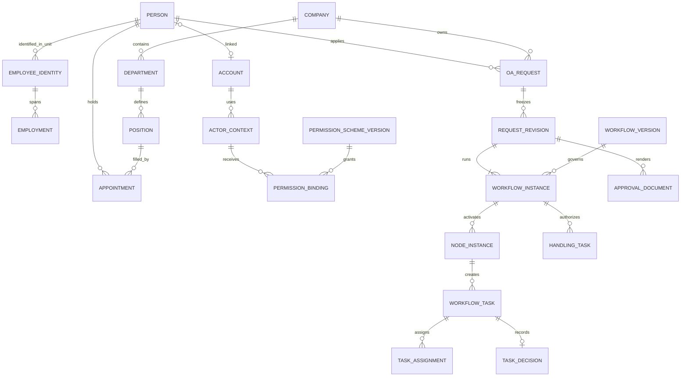

# 项目账号权限、人员组织与 OA 审批融合重构执行方案

> 编制日期：2026-10-30。状态：实施中；完成项须有本轮源码及验证证据。
>
> 用户确认的范围：主要融合账号、权限、人员、组织、模块显隐与 OA 审批。业务员的客户、供货商资料与单证报关资料保持独立，不补入业务到单证的实际衔接；单证继续通过 Excel 导入或手工录入。各业务保留自己的状态、专业界面与原有功能。不需要兼容旧数据库和被替换的旧接口。2026-10-30 用户已授权完整实施、修订文档、定向清理无用测试输出，以及合并推送 GitHub main 并清理其余分支。
>
> 本文描述设计、逐项实施任务和交付边界；勾选状态须结合[验收台账](./OA重构验收与功能保留台账.md)中的实际证据与限制阅读。当前运行事实以[当前架构事实](./当前架构事实.md)为准，schema 10 的历史实施范围见[OA 统一模型实施清单](./OA统一模型重构实施清单.md)。

## 1. 执行目标与范围

### 1.1 最终成果

建立一套供整个项目使用的账号、人员组织和授权基础，完善 OA 的流程配置、审批、办理、交接与审计。销售、客户、供货商、单证、付款打印、工具等原有模块使用同一身份与授权体系，同时继续维护各自的数据、状态、界面和专业规则。

业务员维护的客户、联系人、供货商和产品资料，不与单证报关的客户、出口商、商品及票面资料合并或建立新关联。单证保持原来的 Excel/托单导入、手工录入、原制单基础资料选用和编辑方式，无须先建立销售客户、商机、报价、业务交接或 OA 申请。

本轮完成标准包括：共用身份权限与 OA 目标落地，以及原有功能经必要权限适配后的完整回归。第 1.4 节是原功能保留清单，不是要求重构所有业务数据或补齐跨域经营链路。

| 范围 | 本轮交付 |
| --- | --- |
| 账号与身份 | 账号、人员、任职/协作身份分离；统一登录上下文、停用、会话和授权期限 |
| 组织与人员 | 单位、部门、岗位、雇佣、任职、汇报、职责、公开目录和私密档案；入转调离返聘与未来生效 |
| 权限与模块显隐 | 角色方案、资源动作、数据范围、字段权限、管理授权及权限来源；功能禁用与菜单偏好分离 |
| OA 配置 | 流程目录、13 类专用申请表单与受控扩展字段、不可变发布版本、条件、找人、审查要点、图形编排和仿真 |
| OA 执行 | 串并行、会签/或签/比例会签、本人回避、独立复核、代理、交接、加减签、退回、子流程、暂停恢复 |
| OA 办理 | 人事生效、财务接收、采购验收、会议室和物品办理；批准与实际办理分别记录 |
| OA 运行与材料 | 工作日时限、提醒升级、异常队列、幂等与重启恢复、材料投影、V3 审批单及原件归档 |
| 原有业务模块 | 保留数据域、状态机、专业界面、导入导出和操作；只调整新身份/授权所必需的引用及调用并回归 |
| 数据库与接口 | 新完整数据库基线；重建目标域模型，保留原业务语义；被替换接口直接退役，无兼容层 |
| 产品交付 | Document、Sales、Full 原有定位及适用功能验收，不能以 OA 成功代替整个程序可用 |

此前草案提出的共享客户/供货商主档、销售资料向单证交接、报价转发票、跨域选择/预填、商业单据审批绑定，以及报销向付款打印转制，均从本轮实施与验收范围中撤除。各业务之间已经存在且仍有效的原功能按原规则保留，不以本方案扩大关系。

### 1.2 保持的产品与工程边界

- 正式团队 OA 运行于 Full Web/Docker + Rust HTTP + PostgreSQL 18。Full SQLite 作为单机测试形态，使用相同的人员身份、发布流程和权限规则。
- Document、Sales 保留原产品定位和个人工作方式，个人单机用户不需要先维护完整 OA 组织、员工与流程才能使用原业务。
- 继续使用 Tauri 2、React 19、Rust 模块化单体；桌面 SQLite、团队 PostgreSQL 的部署边界保持。数据域独立不代表增加物理数据库，不新增 Java/.NET 服务、Redis、外部消息队列或第二套流程库。
- 客户/供货商、单证报关、付款打印分别保留原数据与专业规则。共用登录、权限、受管文件或报表基础不产生跨域资料关联、自动同步或数据访问权。
- 原商机阶段、单据核对/作废、付款打印、申报和邮件操作继续由原用例管理；不为这些操作新增 OA 审批前置条件或改变原确认规则。
- 本轮 OA 覆盖现有 13 类行政/人事申请及其办理。完整 BPMN 2.0 互操作、ERP/银行连接器、考勤薪资、WMS、采购订单平台、电子签章、外部门户、业务到单证衔接不属于本轮。
- 项目职责如用于 OA 找人，只作为有限审批范围，不建立项目经营系统，不关联客户或单证。AI 不参与最终授权或自动批准。

### 1.3 不兼容旧库与旧接口的具体含义

1. 采用完整新库基线。P0 已固定目标 schema 11；SQLite/PostgreSQL 的初始化、模型指纹、备份恢复及包身份同步使用该基线，不同结构不能共用版本身份。schema 10 为上一批历史基线。
2. 新程序只接受目标基线，不提供 schema 10 或更早版本迁移、降级、自动修复、旧备份导入或旧试验数据映射。
3. 被新模型替换的账号权限、人员组织和 OA 端点、DTO、权限元数据与客户端方法直接退役；不提供双读、双写、路由别名、旧正文解析或运行时兼容开关。
4. 原业务接口按实际影响处理：只因身份/权限引用变化而需要调整的接口同步修改；未受影响的业务契约继续使用。这是保留有效实现，不是兼容被替换接口，也不要求为统一命名重写全部业务接口。
5. 新基线包含原业务所需的全部表和资源引用，但不合并客户/供货商与单证资料，不重设其业务状态。新身份引用在新库中直接建立，不建设旧 ID 映射库。
6. 使用显式新 DataRoot 或新的 PostgreSQL 数据库。旧库、原程序、用户备份和当前未提交改动保留；启动器不得删除、清空或覆盖已有库。
7. 原来面向用户的 Excel/托单导入格式、手工录入和正常新库业务录入继续保留。拒绝旧数据库/旧备份不等于取消这些原业务导入功能。

### 1.4 原有功能保留与权限适配清单

清单依据当前导航源码、[功能迁移核对表](./Rust原生功能迁移核对表.md)、[导航说明](./导航与页面简化说明.md)及当前架构事实建立。P0 登记已有入口、操作、数据、权限、输出、测试和已知缺口；发现遗漏时补入。原基线尚未验收的能力仍标注待验，不将历史结论写成新模型已通过。

| 编号 | 原有功能域 | 必须保持的专业能力 | 本轮适配与回归边界 |
| --- | --- | --- | --- |
| F01 | 启动、登录、产品版本、许可与更新 | Tauri 生命周期、Web 登录、Document/Sales/Full 裁剪及 updater 信任 | 使用新身份/能力基础；个人单机正常工作，新库与前后端一致 |
| F02 | 工作概览、我的待办、文件任务 | 单证/销售概览、原业务待办、任务进度/取消/下载/重试 | 原业务信息和 OA 任务按各自授权显示；不新增业务到单证交接待办 |
| F03 | 客户、联系人、跟进 | 目录、详情、联系资料、跟进计划、导入导出和草稿 | 保留销售域数据与归属规则，只适配账号/权限，不连接制单客户 |
| F04 | 商机与报价 | 阶段、金额/币种、相关资料、历史和归档 | 保留原状态及专业页面，不新增向单证交接、转单或商业审批 |
| F05 | 供货商、联系人、产品与评价 | 档案、子资料、评价确认、概览与权限 | 保留供货商域和评价规则，不与单证资料或 OA 采购强制共档 |
| F06 | 制单基础资料 | 制单客户、出口商、商品、港口、单位、银行及字段候选 | 保持制单域独立维护/选用；内部任职单位不代替票面主体 |
| F07 | 发票制单与商品明细 | 原五页签、表格、滚动、复制粘贴、撤销重做、金额调整和草稿 | 原 Excel/托单导入及手工录入可直接制单，无销售/OA 前置步骤 |
| F08 | 实际/报关数据与单据核对 | 两类数据、同发票号关联、复制/生成另一类型、核对/作废 | 保留现有关系、状态及计算规则；不统一改为 OA 审批状态 |
| F09 | 查询、统计、利润和汇总 | 日期/客户/商品检索、明细导出、原币及利润口径 | 适配新授权过滤，保持实际/报关去重和业务金额口径 |
| F10 | 付款与报销打印 | 原四页签、单号/参考号、费用、备用字段、私人模板和 PDF | 独立填单与打印，保持现状；OA 报销不自动或显式转制打印单 |
| F11 | 模板与设计器 | 六类默认票面、空白设计、V3 字段/表格/图层、样式、历史和共享 | 共用报表能力与权限基础；商业票面保持原合同 |
| F12 | Excel、托单与批量导入导出 | 原识别器、导入模板、预检、字段映射、容量和批量包 | 保留现有格式与直接导入路径，不查询销售客户/供货商进行匹配 |
| F13 | OCR 与信用证辅助 | 图片/PDF 识别、复制/套用、导入/审查和取消迟到响应 | 保留原草稿回填与辅助能力，权限变化不造成草稿串写 |
| F14 | HS、申报参考与年度维护 | 编码、词典、归类、年度有效性、预检及清理保护 | 保留原引用和历史值、维护操作，只适配新授权 |
| F15 | 单一窗口与申报交接 | 字段映射、校验、批次、受控输出/持卡机交接与回执 | 原单证到申报工具的操作保留；不新增销售衔接或 OA 准入 |
| F16 | 装柜模拟 | 柜型/货物、方案保存加载、空间模拟、编辑与版本保护 | 保留原独立使用和已实现的数据取用方式，不增加销售域关联 |
| F17 | 邮件与汇率 | 写邮件、附件、策略、模板/历史、投递结果；牌价与获取 | 保留现有发送和套用规则，撤权复核有效，无新增审批前置 |
| F18 | 业务资料、原件与归档 | 分类、原文件、历史版本、有效版本确认、预览下载与备份 | 保持原归属和关系，复用文件能力但不扩展跨域材料访问 |
| F19 | 人事、组织与行政协作 | 人员/通讯录、13 类申请、资源、公告、通知、办理与交接 | 按本文目标重构，与全项目账号和权限基础一致 |
| F20 | 系统管理、审计、设置与维护 | 权限、参数、路径、备份恢复、任务清理、诊断、许可及部署 | 全库与受管资源完整保留；恢复后各数据域独立且授权正确 |

每个 F 项最终有“保留操作、必要适配、真实验证、剩余限制”记录。只检查菜单或页面存在不算回归；不兼容旧库与接口也不等于删除原功能。

## 2. 设计依据与现状差距

### 2.1 成熟产品的取舍

以下官方页面已在本次会话查阅。它们用于确认公开能力，本文中的表结构和执行语义为本项目自主设计，不推断厂商内部实现。

| 来源 | 借鉴内容 | 本项目取舍 |
| --- | --- | --- |
| [泛微 e-workflow](https://workflow.weaver.com.cn/) | 流程设计、执行、运维、分析闭环；岗位找人、业务联动 | 设置流程责任人、制度依据、办理结果及异常管理；采用内部受控动作 |
| [致远 BPM](https://www.seeyon.com/NewPro/desc/id/20.html) | 多版本、仿真、加减签、回退与组织匹配 | 统一版本与运行模型，逐项定义高级操作，不照搬完整微服务平台 |
| [致远组织管理](https://www.seeyon.com/NewPro/desc/id/23.html) | 组织主数据、兼职、多维组织、分层分权 | 人员、雇佣、任职与账号分开；单位与项目职责单独建模 |
| [华天动力集团版](https://www.oa8000.com/html/jituanoa/index.html) | 统一用户、统一待办、分级管理、查看/操作/管理权限分离 | 统一工作中心与服务端授权；办理资格不等于审批资格 |
| [蓝凌 EKP](https://www.landray.com.cn/static-old/solution/ekp/index.html) | 字段权限、审批要点、仿真、流程效率及岗位工作台 | 节点材料投影、审查清单、运行解释与分角色入口 |
| [通达 T20](https://www.tongda2000.com/t20/) | 多维组织、矩阵职责、一人多岗、细粒度动作和流程建模 | 支持项目/业务职责与受控流程图，不引入任意脚本执行或完整低代码平台 |

### 2.2 起点与处理方式

核对起点为 2026-10-30 工作树，HEAD 为 `e9c1aa8a`，另有未提交的 OA 集成修改。该编号不是包含全部工作树内容的交付快照。P0 应先记录实际源码状态，再决定改造顺序。

| 当前能力/结构 | 判断 | 重构方式 |
| --- | --- | --- |
| 人员与账号分离、多单位任职、业务身份、独立管理授权 | 已有有效基础 | 保留语义，补齐雇佣期间、岗位和职责实体，统一身份入口 |
| 不可变流程版本、提交轮次、审批任务、会签/或签、代理及交接 | 已有实现 | 提炼成新执行内核，保留真实回归样例；不能重复标为从零开发 |
| 13 类申请、审批中心、办理分工、资源交付、V3 审批单 | 已有实现 | 作为新内核业务适配器接入，保持专用表单与原件归档 |
| 组织等关系表与通用 records 正文同事务维护 | 有约束、有一致性设计 | 核心事实改为专用关系模型；保留必要快照，取消目标域正文与关系同步链 |
| workflow_tasks 为查询投影 | 不是独立状态源 | 新任务与节点实例成为核心运行事实，查询视图只读并可重建 |
| 权限来源、限制优先、事务内复核、后台任务复核 | 已有实现 | 复用同一授权链，补齐类型化范围与节点字段投影，覆盖全部调用面 |
| 客户/商机、供货商、制单主资料分别维护 | 用户明确要求保持独立 | 保留各自数据、状态和专业页面；只适配共用身份/授权，不建立主档关联或业务交接 |
| 发票/实际报关、付款打印、模板、工具、申报与邮件 | 原有核心功能必须保留 | 回归 Excel/手工输入和原完整操作；不新增 OA 审批、转单或输出审批门槛 |
| OA 报销与付款打印当前独立 | 当前边界与本轮范围一致 | 继续独立；财务接收不创建、预填、关联或改写付款打印单 |
| 子流程、指定节点退回、加减签、比例会签、图形编排、自动升级 | 当前文档明确未实现 | 本轮分阶段补齐，见 P4–P6 及对应验收编号 |
| 当前/历史验证 | 有实际证据，也有独立平台缺口 | 作为基线参考；新模型、新库和新接口必须重新取得受影响范围证据 |

## 3. 统一领域模型

### 3.1 组织、人员、任职与职责

| 对象 | 唯一职责 | 约束 |
| --- | --- | --- |
| 组织单位 | 表达 Group 管理层或 Company 经营单位 | 业务归属 Company；父子隶属不自动授予业务访问权；不把集团等同多租户 |
| 部门 | Company 内的行政层级 | 父部门必须同单位；代码单位内唯一；循环及跨单位父节点在事务中拒绝 |
| 岗位 | 稳定的工作位置/职责位置 | 可空缺、可多人承担；职位显示名称与岗位 ID 分开；不按名称授予权限 |
| 人员 | 同一个自然人的稳定身份 | 姓名可重名；人员编号全局唯一；离职、返聘、换账号不创建另一份同人历史 |
| 雇佣关系 | 人员与雇佣单位的一段关系 | 引用稳定的单位人员身份；返聘创建新期间；劳动关系和跨单位兼任不同 |
| 任职 | 人员在某单位、部门、岗位的履职关系 | 主职、兼职、借调统一；岗位可以不同，不能再用“人员+单位+部门”阻止同部门多岗位 |
| 汇报关系 | 任职之间的行政/职能汇报 | 指向任职，不指向姓名；拒绝自环、循环、无效引用；顶层任职可无上级 |
| 业务职责 | 财务复核、采购验收、印章保管、公司分管等责任 | 限定单位、业务类别、可选部门/项目、承担任职及有效期；职责分配不等于操作授权 |
| 项目职责 | 临时或持续的项目审批分工 | 项目本身有经营单位、负责人和成员期限；不建立完整项目管理产品；不越过单位边界 |
| 私密档案 | 证件、合同、家庭和其他敏感人事信息 | 与公开目录物理/查询分离，按字段分类和档案责任单位授权 |

统一规则：

- 一个人可以有多个雇佣期间及多个任职，任职不要求每次跨公司兼职都创建另一份劳动关系。跨单位任职必须明确任用单位及授权来源。
- 工号属于“人员+单位”的稳定关联：同单位同工号只绑定一个人，同人返聘可以复用；多个雇佣期间引用这一关联，不能因雇佣期间表的工号唯一约束阻止返聘。不同人员不得复用已有历史的工号。
- 主职表示人员默认展示与默认业务身份，不代表权限更高。对于任意业务日期，一人最多一个有效主职；历史和未来任职允许保存，禁止有效区间重叠导致双主职。
- 时间点按 RFC 3339，业务日按严格日期类型。雇佣区间采用起点包含、终点不包含；任职沿用明确的“最后任职日”合同，结束当天有效，空日期表示开放边界。两种期间在各自领域校验及 SQL 查询中保持一致，不混用结束日含义；当前字段事实见数据字典。
- 组织代码、工号、登录名是业务属性，不作为新模型外键；改名、改代码不能改变实体身份或历史归属。
- 未使用的误建资料可删除；有业务、签署、任职或审计引用时结束有效期/停用，不能级联删除历史。
- 通讯录返回姓名、工号、工作联系方式及任职摘要；读取公开候选不能顺带加载私密档案。

### 3.2 人员变更单与生效

入职、转正、调岗、离职、返聘统一使用人员变更单，正式变更按已发布流程批准后调用同一生效用例。首次建档与普通档案维护按明确管理权限操作，不伪造审批历史；Full SQLite 与 PostgreSQL 不保留各自不同的直接登记审批分支。

| 变动 | 生效行为 |
| --- | --- |
| 入职 | 建立人员或关联已确认的既有人，创建雇佣与任职；账号开通为明确任务，不自动借用他人账号 |
| 转正 | 更新对应雇佣阶段与日期；不隐式提权 |
| 调岗/兼职调整 | 关闭或变更任职有效区间，建立新任职/汇报/职责，按明确授权规则变更权限 |
| 离职 | 结束雇佣及相关任职，撤销对应授权、处理账号状态，保留人员与完整历史 |
| 返聘 | 复用人员身份，创建新雇佣期间和任职；旧权限、旧代理与账号启用状态不自动恢复 |

流程通过后，立即生效或进入“待生效”。到期任务保存批准版本、业务日期、执行身份与幂等键；执行前复核目标版本、组织有效性及交接条件。冲突进入待处理队列，不静默覆盖后续人员变化。

交接及影响清单覆盖流程职责、未激活及当前任务、代理、办理分工、借用品、会议安排、待生效变更、后台任务及原业务归属。OA 待办通过受控交接处理；客户/发票/付款等按原模块已有归属规则处置，不要求新增业务交接单或批量改写历史 owner。按权限显示数量、可执行动作及结果，不用受分页限制的展示列表推断“无引用”。

正常撤任先完成交接；安全紧急停用立即撤销会话和访问，将未结事项置于待交接状态。账号安全禁用不得被“还有任务”阻止；恢复账号也不自动恢复已撤销的业务授权。

### 3.3 共用身份与独立业务数据

| 概念 | 本轮规则 |
| --- | --- |
| 账号/人员/任职 | 是操作者及内部责任人的共同身份基础；原业务只调整必要引用，创建人与当前负责人分别保留 |
| 内部组织单位 | 用于任职、授权和已有业务归属；不与出口商、买卖方、收款单位等票面资料合并 |
| 销售客户/供货商 | 保留销售域的主档、联系人、产品、评价和历史；同名不触发制单域关联 |
| 制单报关资料 | 继续由原 Excel/托单导入、手工录入及制单域基础资料选用产生，不取销售主档作为前置来源 |
| 商品/银行资料 | 各业务继续按自身模型维护和使用，不建设跨域统一商品、联系人或银行主档 |
| OA 申请材料 | 由 OA 专用表单和附件形成冻结版本；本轮不将发票、报价或付款打印单变为审批对象 |
| 共用文件/报表能力 | 复用存储、输出、任务和安全校验；各域保留资源归属、容量、模板和访问规则 |
| 人员停用/责任调整 | OA 任务按审批交接处理；原业务按已有归属/授权规则处置，不复制数据到另一业务域 |

销售联系人和内部员工是不同对象，不能因姓名、手机或邮箱相同自动建立人员档案关联。一个账号兼有销售和单证权限时，是分别获准使用两套业务功能，不会因此生成资料映射、同步或新数据关系。

### 3.4 各业务继续拥有自己的状态

| 状态 | 权威模块 | 本轮处理 |
| --- | --- | --- |
| 客户跟进、商机阶段、报价及供货商评价 | 原销售/供货商用例 | 保留原规则与操作，不新增商业审批阶段 |
| 发票草稿、核对、实际/报关、作废 | 原单证用例 | 保留原状态、计算及转换，不与 OA 状态互相驱动 |
| 付款/报销打印单 | 原付款打印用例 | 保留独立保存、打印和原状态，不消费 OA 批准结果 |
| 申报、邮件及文件任务 | 原工具/任务用例 | 保留原执行与外部结果语义，不因 OA 审批重定义 |
| OA 审批决定 | OA 流程内核 | 管理申请提交版本、节点任务及签署历史 |
| OA 实际办理 | 人事/行政资源等对应办理用例 | 处理人员生效、财务接收、验收/发放/归还，与批准分别记录 |

账号或权限变更只改变访问和可执行操作，不把原业务记录改成 OA 状态，不自动批准、核对、作废或覆盖其正文。原界面的字段、页签、草稿保护和专业工作路径继续保留。

## 4. 统一身份、授权与模块显隐

### 4.1 身份上下文

Full 的业务请求必须选择一个服务端签发的身份：正式任职、临时协作或管理身份。上下文包含账号、稳定人员、任职/协作授权、当前经营单位、授权版本和期限。跨单位审批通过目标单位的协作授权完成，不把其他身份的权限并入当前请求。

Document/Sales 保留已有个人运行身份和所有者语义，共用授权基础设施，但不伪造员工档案或强制建立 OA 任职。平台维护账号可以没有人员，但不能因此伪造普通申请或签署。

身份切换需要草稿保护、取消旧请求、轮换令牌、隔离查询缓存和文件任务；任何迟到响应都不得回写新身份页面。只有一个身份时自动使用，有多个身份才显示选择入口。

### 4.2 授权层次和判定

| 层次 | 控制对象 | 生效方式 |
| --- | --- | --- |
| 产品/部署能力 | Document、Sales、Full、编译 feature、许可 | 最外层能力上限 |
| 单位启用功能 | OA、人事、资源等 | 禁用阻止新操作；正常停用先展示在途影响，特殊紧急停用立即拒绝访问 |
| 账号与身份 | 启停、期限、所属单位、任职状态 | 每次请求及最终写事务复核 |
| 角色/权限方案 | 资源、动作、普通数据范围 | 同一身份内明确组合，保留来源和版本，不跨身份合并 |
| 授权上限及限制 | 转授权范围、模块关闭、敏感字段限制 | 取交集；显式限制优先，依赖派生不得重新放行 |
| 对象参与关系 | 本人、审批分派、有效代理、办理分工、抄送 | 只扩展该对象所需的参与访问；不产生通用写入或审批资格 |
| 当前流程状态 | 任务是否有效、可执行动作、独立复核 | 审批必须持有当前有效任务；公司级查看权不等于审批权 |
| 字段与材料 | 字段分类、节点可见/可写、附件分类 | 服务端裁剪响应并验证提交，不依赖前端隐藏 |

普通查看资格可来自“普通数据范围”或“合法对象参与范围”。两者仍受产品、单位、有效身份、查看动作、敏感字段和显式限制约束。审批资格额外要求对应审批动作、当前任务、签署政策和目标单位授权；参与关系本身不授予批准能力。

数据范围使用有限、类型化规则：本人、指定部门、部门及下级、当前经营单位、指定单位集合、明确项目关系、明确任务参与。部门/单位集合比较采用集合包含关系，不再只用 own/department/company 的大小排名表达所有范围。集团统计单独授权，在 SQL 聚合前限定单位集合。

### 4.3 权限方案与管理权

- 权限方案采用不可变发布版本；绑定指向明确版本。复制方案生成独立草稿，组合职责保存明确来源，不形成递归引用或运行时无限继承。
- 新版本批量应用前计算增减权限、单位/字段范围、账号和在途任务影响；应用事务重新校验版本与可授上限。程序升级不自动扩大已保存方案。
- 个人独立授权作为明确例外，保存原因、来源及可选到期时间；界面能够追溯最终允许/拒绝的规则。
- 岗位/职责可以关联已发布授权规则，但分配者必须具有相应转授权上限。通过给自己设置负责人或岗位不能绕过权限管理。
- 分开授予组织维护、任职维护、私密档案维护、流程设计、流程发布、任务运维、权限分配和集团统计。
- 平台管理权不自动成为业务审批权。高风险流程可配置设计与发布分离；角色矩阵必须展示实际责任，不把所有维护操作都归为“管理员”。

### 4.4 模块显隐与前端合同

“禁用功能”“没有授权”“收起/隐藏菜单”是三个不同概念。前两者限制服务端访问；个人偏好仅改变展示。偏好在现有设置存储体系中保存，不新增 LocalStorage 事实源。

服务端提供当前身份的有效功能、路由入口、动作和拒绝原因代码。导航、全局搜索、首页快捷入口、直接地址、按钮和下载使用同一来源；未知能力或缺失元数据默认拒绝。按钮状态只能解释当前结果，写入仍要事务内重验。

提供“我的权限来源”和管理员“以该身份预览权限”，仅模拟授权结果，不创建可冒用他人身份的登录会话。模拟只能查看操作者有权管理的身份和脱敏样例。

### 4.5 各岗位与模块的独立授权

| 职责 | 常用工作 | 授权边界 |
| --- | --- | --- |
| 业务员 | 客户、联系人、跟进、商机/报价、供货商资料 | 按销售域范围授权；获得单证权限需另行授予，不附带客户资料联通 |
| 单证人员 | Excel/手工制单、核对、查询、申报和输出 | 使用制单域资料；不因岗位名称获得销售客户或供货商档案权限 |
| 财务人员 | 获准的付款打印、OA 报销审核或接收 | 打印、审批、接收分别授权；不增加两类记录之间的转换关系 |
| 采购/行政人员 | OA 采购、物品、会议室及验收 | OA 职责不自动授予供货商经营资料访问权 |
| 人事人员 | 公开目录、私密档案、任职、人员变更 | 档案维护、账号管理和权限分配分别授权 |
| OA 审批人/办理人 | 当前任务及获准申请材料 | 任务资格、材料范围、审批动作独立校验，不获得全项目数据浏览权 |
| 模板/资料维护人员 | 各域模板、基础资料、词典和受管资源 | 维护能力不等于全部业务读取/输出能力 |
| 平台维护人员 | 配置、备份、诊断、权限配置和部署 | 管理能力不自动产生申请签署或对外发送资格 |

同一人兼任多个职责时，可以在合法身份下组合独立的模块授权；权限不会通过资料名称、同一客户或菜单分组传播。OA 参与人只查看本申请获准的材料，本轮不新增商业单据材料适配或从审批任务跳入其完整编辑页的特权。

## 5. 流程定义、表单与发布

### 5.1 定义结构

流程定义含稳定 ID、业务类型、所属/适用单位、负责人、分类、制度链接、表单版本、节点图、适用条件、签署政策、办理动作和时限策略。图形视图与步骤列表编辑同一个文档，不维护两套定义。

节点支持开始、审批、条件、并行分叉/汇合、抄送、办理、受控系统动作、子流程和结束。采用明确配对的分叉/汇合与有界前向图；退回由执行命令和新一轮节点实例表达，不向定义中添加无限循环。

定义明确区分“审批决策阶段”和“获批办理阶段”。审批图结束即保存批准结果，并创建办理阶段任务；办理图可以继续执行，但不会把批准结果改回审批中。系统动作及子流程必须声明所属阶段；人员生效、实物交付等有副作用的动作只能在获批办理阶段。办理失败通过办理/技术任务状态表达，申请总体进度由两个阶段组合。提交时的资源占用按第 7 节单独约束，不等同实物交付。

OA 业务类型注册到现有 Rust 组合根，负责专用表单合同、校验、摘要、审批上下文、办理动作和报表数据。现有 13 类行政/人事申请使用同一内核，类型数量不成为流程算法中的穷举分支。通用申请的受控字段不替代报销明细、人事任职和资源预约等专用界面；原发票、销售和付款打印界面继续独立。

### 5.2 条件与找人

- 条件采用有限操作符及 AND/OR 组合，支持已声明的类别、部门、项目、金额/币种、时长及变动类型；禁止任意脚本、SQL、网络请求或宿主路径表达式。
- 金额/数量使用精确十进制，跨币种不直接比较。金额门槛必须指定币种；未配置币种的业务进入明确的默认审核路径或拒绝提交，不默认换汇。
- 排他条件必须唯一命中或命中显式默认分支；发布检查可识别的重叠/缺口，运行时多命中仍拒绝，不以数组顺序掩盖冲突。
- 找人支持指定人员、岗位、业务职责、任职部门负责人、行政/职能上级、项目职责及指定单位/上级单位职责。每一来源保存命中解释。
- 提交冻结流程/表单版本、条件输入、组织与职责解析结果。未来节点的责任候选亦保留快照；激活和签署时复核当前有效性，失效进入交接/异常，不默默换成新上级。
- 同一节点按稳定人员去重；独立复核同时核对实际签署人及其代理关系。无有效责任人、全部回避、岗位空缺或跨单位授权不成立时明确阻止提交/激活。

### 5.3 节点字段、附件与审查要点

字段声明稳定标识、类型、敏感等级、适用业务、是否参与条件/金额/业务生效；布局与字段事实分开。节点定义可见、只读、可填写和必填，最终字段访问为基础授权、参与材料范围、字段分类与节点规则的交集。

提交事实在审批期间不可直接覆盖。审批人填写的核验结果、意见和办理记录保存于节点附加数据；如修改金额、申请人、日期、收款对象等提交事实，必须退回并产生新提交版本。条件解释、日志、搜索、统计、通知、PDF 和附件下载均遵守同一敏感字段边界。

审批要点包括制度依据、需核验事项及是否必须确认。批量审批仅开放于定义显式允许且没有待填写核验项的任务；每项分别授权、检查版本并报告结果，不能把批量按钮当作一次无差别批准。

### 5.4 发布管理

定义状态为草稿、可发布、已发布、已停用；发布版本不可变，启用指针独立。版本发布与启用在同一事务完成，避免“显示发布成功但启用失败”的模糊状态。定时启用保存持久任务并在生效前复核冲突。

发布必须通过：图结构、条件覆盖、人员职责、授权上限、独立复核、字段必填可达性、模板引用、子流程版本、边界容量与样例仿真。仿真不写正式业务，不发送通知；正式提交使用同一解析器并重新核对。

统一模板库通过复制或显式采纳新版本供下属单位使用，不能由总部修改模板后静默改变所有单位的在途流程。已发布的旧版本只能停止新发起；在途继续按绑定版本完成。

### 5.5 原业务接入共用授权的合同

原业务页面及服务端用例接入新账号、人员身份、组织范围和权限判断。原有资源动作、数据归属、编辑状态、导入导出与输出规则继续由各模块负责，不增加“提交 OA 审核”“等待审批后核对”“批准后转单”等步骤。

每个原模块只核对四类适配：当前操作者身份；原 owner/单位等必要引用；资源动作与数据范围判定；导航、按钮、列表、文件及后台任务的撤权响应。若无需改变业务 DTO、表字段或界面，则保留现有实现。

审批配置只登记本轮 OA 申请类型及实际办理动作。后续如需商业单据审批或业务到单证衔接，应另行形成需求、状态与权限设计，不作为本轮隐藏前提或预埋必交数据结构。

## 6. 执行状态与高级操作

### 6.1 状态职责

| 对象 | 状态/结果 | 权威性 |
| --- | --- | --- |
| OA 申请展示状态 | 草稿、审批中、退回修改、已批准、已驳回、已撤回、已作废及办理进度 | 从草稿/审批实例/办理任务组合，不另建独立可写总状态 |
| 审批实例 | Running、Returned、Approved、Rejected、Withdrawn、Terminated；暂停为运行控制状态 | 审批决定的权威记录，与节点/任务同事务变化 |
| 节点实例 | Pending、Active、Completed、Skipped、Cancelled、Blocked | 每次激活有独立实例编号及执行代次 |
| 审批任务 | Queued、Ready、Completed、Cancelled；批准/驳回/退回为独立结果 | 未签署的取消/无需办理不记录为同意 |
| 办理任务 | Pending、InProgress、Completed、Cancelled、Blocked | 表示实际交付，不由批准替代 |
| 技术执行任务 | Ready、Running、Succeeded、Failed、Uncertain、Cancelled | 技术失败不改写已成立的批准决定 |

原销售、单证、付款等状态保留在各自模块，不进入本表，不与 OA 状态互相驱动。

`oa_requests` 保存稳定申请 ID、单位、申请人及当前草稿/提交指针。每次正式提交形成不可变 `request_revisions`，保存正文、附件版本、组织快照和绑定流程版本，并创建一个根审批实例。退回修改后的重提产生新提交版本及新根实例；正文不变的指定节点重审保留提交版本，在原实例中增加执行代次。子流程保存父实例及输入快照关系。

旧意见、任务、路由和材料完整保留，不通过复用行号把上一轮签名归入本轮。OA 不复制商业单据主记录，也不建立商业单据审批绑定或共用业务版本中心。

### 6.2 操作合同

| 操作 | 前提 | 必须完成的原子变化 |
| --- | --- | --- |
| 提交 | 草稿合法、身份有效、材料完整、命中已发布定义 | 冻结版本，建立实例/节点/任务，更新资源占用，写事件及幂等记录 |
| 同意 | 当前任务可签署、核验项完成、独立性成立 | 写实际人员/账号/身份/代理及意见；完成节点或等待其他任务；激活合法后继 |
| 驳回 | 节点允许驳回 | 按发布的否决政策结束或累计否决；最终驳回取消未结任务，释放应释放资源 |
| 退回申请人 | 尚未产生不可逆办理结果 | 关闭未结审批，生成可编辑草稿入口，保留本轮全部事实 |
| 指定节点退回 | 目标为本实例已执行的允许重审节点，且未跨不可逆办理边界 | 取消目标影响范围内的未结任务，建立新的执行代次；保留原签名及重审原因 |
| 撤回 | 发起身份有权、流程允许、未越过办理边界 | 关闭当前审批并释放相关占用；后续编辑产生新版本 |
| 转派/交接 | 接任人的单位、任职、操作资格与独立性均成立 | 结束原分派、建立新分派、保留原责任与原因，旧任务入口失效 |
| 暂停/恢复 | 有流程运维权限并填写原因 | 冻结/恢复新动作与定时策略，记录期限计算依据；不补造签名 |
| 终止/作废 | 有明确操作权并满足业务撤销政策 | 终止审批或作废已批版本，建立必要补偿任务，不删除历史 |

指定节点重审默认保持提交事实不变；若修改了提交事实，默认从新一轮完整审批开始。仅在流程显式定义且仿真证明影响边界时，允许局部重审。重新利用未受影响的批准时必须引用原批准记录及同一材料摘要，不能复制为新的签署。并行汇合只消费本次执行代次中应等待的分支结果，不能因某一旧分支已完成而提前通过。

### 6.3 会签、加减签、代理与子流程

- 会签要求全部有效签署人批准；或签一人批准后其余任务关闭为无需办理。比例会签在节点激活时冻结去重后人数基数与阈值，向上取整；拒绝政策单独声明，不由“未达到通过数”猜测。
- 必须区分立即否决与继续收集意见。人数为零、阈值无法达到、拒绝已使阈值不可达到，均按定义产生明确结果或异常。
- 加签分为前加签、后加签、并行加签；仅在节点政策授权范围内增加任务，不直接授予被加签人业务权限。新增责任人先校验目标单位授权和敏感材料范围。
- 减签不能移除必经职责、独立复核或最低人数。运行中的人数变更属于记录在案的节点修订，明确新基数和阈值，执行变更本身不得使流程自动通过。
- 代理限定单位、业务、期限及是否允许继续转派；本轮仅支持直接代理，不允许递归代理。保存原责任人、实际人、身份和代理记录；抄送、咨询不计入批准票数。
- 子流程绑定明确发布版本和输入输出合同，输入取父流程冻结材料；禁止递归引用，限制层级及任务总量。父流程等待子流程结果；子流程拒绝、取消、异常和补偿的传播政策在定义中明确。
- 项目职责审批使用明确项目成员关系、业务授权和单位边界，不以“加入项目”获得所有相关客户/单证资料。

## 7. OA 申请与办理闭环

### 7.1 办理边界

OA 审批完成后，只调用本申请类型已声明的办理用例：人员变更生效、财务接收、采购验收、会议室或物品交付等。流程内核不直接改写其他模块 SQL，不复制专业校验，也不将原销售、发票、单证或付款打印状态纳入运行图。

OA 报销与原付款/报销打印保持独立，财务接收不创建、预填、关联或更新打印单；打印单继续按原四页签手工填写和输出。OA 采购使用本申请的供应方说明及材料，本轮不要求关联销售供货商主档或单证资料。

### 7.2 行政与人事 13 类申请

| 业务类型 | 保留/补齐的专用能力 | 批准后的结果 |
| --- | --- | --- |
| 请假 | 类型、时段、重叠校验、材料、销假 | 销假/结束记录；不宣称已扣假期余额或同步考勤 |
| 加班 | 时段、时长、重叠校验、实际确认 | 实际加班确认；不自动计算工资 |
| 报销 | 费用明细、币种、票据、申请主体、审查材料 | 财务接收/退回核验；不等同已付款或已记账 |
| 出差 | 行程、时段、预算/材料、实际归档 | 出差办理和归档，可关联后续报销，不复制金额事实 |
| 采购 | 明细、数量、币种、用途、申请内供应方信息/材料、验收 | 采购办理和验收；需要物品入库时调用已有用例，不强制接通销售供货商或单证资料 |
| 通用申请 | 分类、用途、受控扩展字段、印章/证明等办理职责 | 指定责任人实际交付，保存结果材料 |
| 会议室 | 时段、资源、附件、冲突、交接 | 草稿不占用；提交占用时段；取消释放；已交接走专门归还/终结 |
| 物品领用 | 物品明细、库存、借用/消耗、发放与分次归还 | 最终批准事务检查并预留；不足时保存已批准及待协调办理任务，不建立负库存；发放扣减，借用品归还 |
| 入职 | 人员识别、拟雇佣/任职、账号任务 | 建档/任职立即或按批准日期生效 |
| 转正 | 雇佣阶段、评定及日期 | 更新雇佣阶段 |
| 调岗 | 主职/兼职/借调、汇报、职责、授权影响 | 生效与交接，保留原任职历史 |
| 离职 | 人员状态及完整交接清单 | 结束有效关系、撤权和账号处理 |
| 返聘 | 已有人识别、新雇佣期间/任职 | 保留同人历史，不恢复过期职责 |

审批通过、实际办理完成、技术输出完成分别可观察。审批通过不能直接表示付款、用印、验收、领钥匙或实物发放。会议室提交遇到时段冲突时整次提交失败，不建立审批实例或占用。物品因审批期间库存变化而不足，批准决定保留，办理进入待协调；再次预留仍须原子检查，不自动扩大批准数量。

立即生效的人事变更在最终批准事务内复核目标版本并生效，冲突使本次签署与变更整体回滚；未来生效的变更先保存批准及定时任务，到期发生版本/组织冲突时保留批准历史并进入生效异常。数据库故障始终按真实依赖错误回滚，不能包装为库存不足或待协调成功。

对于批准后的撤销：未办理的任务按业务规则取消并释放预留；已发生实物或外部操作时，创建退还、冲销或人工核对任务。不得用删除批准记录表示现实动作已经撤销。

## 8. 新数据库与存储设计

### 8.1 权威数据和表组

新完整基线承载整个项目，但本轮重点重建账号权限、组织人员与 OA 模型。原销售、供货商、制单、付款等模型按原业务语义纳入新基线，只调整引用新账号/人员/组织所必需的字段与约束，不趁新建库合并业务资料或重设专业状态。

P1 输出 SQLite/PostgreSQL 两份完整 DDL、字段字典与索引清单。可复用职责正确的现有表，不同时保留目标域的两套权威正文。

| 表组 | 核心实体/候选物理表 | 必须具备的约束 |
| --- | --- | --- |
| 组织 | organization_units、departments、positions | 单位内部门/岗位唯一键、同单位父级 FK、类型及停用保护 |
| 人员 | persons、employee_identities、employments、appointments、reporting_relations | 稳定人员 ID、单位工号绑定、雇佣/任职期间、主职区间唯一和汇报有效性 |
| 档案/账号 | personnel_private_profiles、accounts、现有 credentials/会话存储 | 普通账号与人员一对一；独立维护账号例外；私密档案单独查询，凭据不进入快照 |
| 职责 | responsibilities、responsibility_assignments、project_scopes、project_memberships | 单位/部门/有限项目范围、任职 FK、有效期；不关联销售或单证主档 |
| 身份/授权 | actor_contexts、permission_schemes、permission_scheme_versions、permission_bindings、administration_grants、access_restrictions | 来源、版本、资源动作、范围、期限、单位一致性及转授权上限 |
| 流程配置 | workflow_definitions、workflow_versions、workflow_publications、form_versions | 定义版本唯一、发布不可变、活动指针明确、子流程版本 FK |
| OA 申请 | oa_requests、request_revisions、各类专用申请明细/人员变更单 | 申请编号、申请人/单位、版本号、不可变提交、金额币种及专用业务约束 |
| 流程运行 | workflow_instances、node_instances、workflow_tasks | 提交版本 FK、每版一个根实例、父子关系、轮次/执行代次及状态约束 |
| 分派/签署 | task_assignments、task_decisions、workflow_operations、workflow_delegations | 人员/账号/身份引用、有效分派唯一、同次任务签署唯一、原责任与实际责任 |
| 办理/资源 | handling_tasks、personnel_change_orders、现有资源及流水 | OA 提交版本、办理幂等键、资源约束和未来生效时间；人员变更单为同一实体，不重复建表 |
| 时限/执行 | business_calendars、现有持久任务扩展、事件待投递记录、command_receipts | 租约、去重、期限、执行结果及请求摘要一致性 |
| 材料/历史 | 现有文件存储、OA 附件版本引用、approval_documents、审计事件 | 所属提交、分类、摘要、历史不可改、无跨单位悬空引用 |
| 销售/供货商原模型 | 原客户/联系人/跟进、商机/报价、供货商/产品/评价 | 保留专业结构与状态；必要账号/归属引用适配，不引用制单主档 |
| 单证/付款原模型 | 原制单基础资料、发票明细、实际/报关关系、付款打印及专业字段 | 保留 Excel/手工输入、原唯一键/金额/文本/状态，不建立销售来源或 OA 审批 FK |
| 其他原模型 | 模板素材、业务资料、HS、申报、邮件、配置、通知与后台任务 | 保留原关系和规则，仅适配必要身份/授权引用；新库备份覆盖完整资源 |

`oa_requests` 是 OA 申请主记录，`request_revisions` 是其不可变提交事实。一个提交版本只能有一个根实例；子实例通过父实例关联并固定输入。正文、附件引用、签署和办理结果分别保留，不以可修改的统一 JSON 总状态覆盖它们。

本轮不建设统一商业对象登记表、跨域业务版本中心、业务交接表、商业审批绑定表或新交付清单体系。不同业务可以引用同一内部账号/人员/组织基础，这类内部身份关系不构成客户、商品、供货商或单证资料联通。

### 8.2 核心设计规则

1. 新实体采用类型化稳定 ID；物理 ID 沿用 SQLite INTEGER/PostgreSQL BIGINT 能力，新域 API 以十进制字符串传输，避免 JavaScript 精度损失，展示编号独立。原业务 ID/接口仅在实际受影响时调整。
2. 组织、账号、任职、授权、OA 实例与任务核心状态使用关系表。只移除被替换目标域的 records JSON 同步链，不顺带重写全部原业务 records 模型。
3. JSON 用于不可变流程定义、受控扩展与提交快照；常用权限过滤字段、唯一键、状态、责任人、期限和金额币种使用可约束/索引字段。
4. 状态由对应应用用例事务推进；审计记录当时事实。查询投影只读可重建，不建设全量事件重放系统。
5. 写入使用版本条件；重复操作由状态、版本及唯一约束共同阻止。单位一致性通过组合 FK 或同等数据库约束保障。
6. 任职重叠、组织/汇报循环在同一写事务检查；SQLite/PostgreSQL 执行同一业务合同，并分别加强数据库约束。
7. 新 OA 数量/金额使用精确十进制及规范字符串契约；SQLite 无损编码，PostgreSQL 使用明确精度或等价无损编码。原单证金额传输、舍入和付款自由文本规则保持。
8. 业务日、时间点、工作日历分开；时间点具有真实时间语义，保留展示偏移/时区依据，不按混合偏移字符串字典顺序排序。
9. 历史签名、任职、批准材料及原业务历史禁止级联删除。删除误建对象须完整检查引用；私密字段不进入通用搜索、通知或日志。
10. 优先索引单位/状态/时间、人员有效任职、授权期限、责任人/任务/期限、申请/实例/节点及幂等键。列表、计数、导出和汇总在 SQL 授权过滤后执行。
11. 沿用单 API 实例及已有事务协调，不因此宣称支持多 API 水平扩展。两库分别验证并发、取消、繁忙及完整回滚。
12. 新全库基线校验所有原业务的账号、owner、单位和受管文件引用。原创建/修改人历史不能被当前任职或接任人覆盖；不增加销售客户与制单客户的引用关系。
13. 复用受管文件的类型/容器、大小、摘要和路径校验；业务资料与 OA 附件保留各自容量和版本规则。现有安全缺口在证据中列明，不能默认已通过。
14. 字段字典明确 NULL/空值、默认值、更新条件及删除保护；普通 API 不持有建表权限。只有数据库不存在时才允许初始化，拒绝旧库不修改原库。

### 8.3 关系示意



图中同一提交版本对应一个根实例和可选子实例，DDL 额外约束根实例唯一。独立维护账号可以不关联人员；申请必须有合法申请人/任职或明确代办关系。销售、单证和付款表不进入 OA 运行链；它们继续以各自模型关联内部身份与权限范围。

## 9. 新 API 与跨模块契约

### 9.1 接口族与职责

以下为规划的接口族，正式端点名称、operationId 和 schema 在 P1 统一进入 `/openapi/v1.json`；本文不建立另一份可执行 endpoint 清单。

| 接口族 | 需要覆盖的命令/查询 |
| --- | --- |
| 原销售/供货商、单证、付款及工具接口 | 保留原 CRUD、导入导出、核对、输出及状态；必要身份/授权变更纳入唯一契约，无新增跨域资料、转单或商业审批接口 |
| 当前身份 | 身份目录、切换、当前能力、权限来源、授权版本 |
| 组织任职 | 单位/部门/岗位/雇佣/任职/汇报/职责 CRUD、变更影响预览、引用说明 |
| 人员档案 | 公开目录、私密档案、账号关联、变更单、交接清单、生效结果 |
| 权限管理 | 方案草稿/发布/应用、身份绑定、限制、管理授权、到期、影响预览 |
| 流程设计 | 目录、草稿、验证、模拟、版本差异、发布、定时启用、停用 |
| 申请 | 类型目录、专用草稿、附件、提交前预览、提交、撤回、重提、详情/历史 |
| 任务操作 | 同意、驳回、退回、加减签、代理、转派、暂停恢复及终止；使用明确命令 DTO |
| 办理 | 待办理、认领/分派、执行、归还/验收、生效、撤销/补偿 |
| 材料与文档 | 节点材料投影、审批单生成/预览/下载、原件归档、有效性核验 |
| 运行管理 | 统一待办、异常队列、时限、统计、执行结果与安全重试 |

### 9.2 必须统一的协议

- 每个操作具有生成的认证、许可、资源动作及对象策略元数据；不使用 URL 前缀或前端路由猜测权限。
- 变更请求携带读取时版本；提交、签署、生效和资源交付另携带幂等键。幂等记录绑定账号/身份、命令、目标、请求摘要与结果；相同键不同正文返回冲突。重复请求仍先检查当前访问资格，不泄露已撤权结果。
- 客户端不能自由指定当前单位、批准人或管理员身份。代填人与实际申请人分别保存；二者均受本人回避规则约束。
- 明确 400 校验、401 未认证/会话失效、403 权限、404 不存在、409 版本/状态冲突、429 容量、503 依赖和 504 超时；业务拒绝使用结构化原因，不吞成空列表。
- 响应包含可执行动作及原因代码、对象版本、当前提交/任务身份。前端以它解释操作，服务端仍在写事务重验。
- 请求取消和提交结果不明分开。数据库事务已经提交时不能因连接断开假装撤销；客户端通过同幂等键查询实际结果。
- 普通列表、通知数量、待办、搜索、报表、导出、附件和后台任务沿用同一身份/对象/字段策略。文件生成后及下载时再次检查，不依赖创建时权限快照永久放行。

### 9.3 旧接口退出与联动面

P0 建立旧 operationId → 新操作/删除理由的核对清单。契约变更时同步更新 Rust/React 生成客户端、HTTP 路由、页面调用、通知深链、测试夹具、示例、脚本和 OpenAPI 基线差异测试。

旧端点从正式契约和路由表移除，按未注册路由处理；没有重定向、旧字段容错或新旧双栈。冻结 C# 基线中对应端点只保留为明确退役的历史证据，其余未变端点继续回归。禁止通过整体更新快照让未说明的认证、错误或权限漂移通过。

必须审查的共用影响面：F01–F20、登录/账号、导航与搜索、内部人员/公司/部门选择器、原业务 owner/单位引用、模板共享、文件任务、通知受众、下载票据、备份恢复及初始化。制单客户/出口商等票面资料选择器保持制单域来源，不能因“统一选择器”改为销售客户目录。

目标域新授权解析直接服务各模块，不保留解释旧权限模型的第二套授权器。原业务流程、表单状态和数据关系不因接口生成或权限元数据更新而扩大。

## 10. 运行可靠性、时限与审计

### 10.1 事务与执行任务

批准命令的事务至少完成：当前身份与任务复核、写签署、更新节点/实例、创建下一步审批或办理任务、资源约束、生成人员变更/业务结果、事件和幂等回执。任一步失败完整回滚。

长时间文件输出和外部动作不占用上述事务。复用并扩展 `engine::tasks` 的持久执行能力和业务库内事件待投递记录，不建立第二套调度服务。任务以短事务领取并记录租约、次数、期限、取消及错误；恢复时依据业务幂等键确认结果。

采用至少一次调度加幂等副作用，不宣称网络请求天然恰好一次。无法判断外部动作是否已执行时进入 Uncertain 和人工核对，不能盲目重试。通知按事件/收件人去重；通知投递失败不回滚已批准业务，重试可观察。

### 10.2 工作日历与升级

- 公司配置业务时区、工作时段、节假日和调休日；时区来自明确配置，不依赖服务宿主时区。节点绑定日历版本及激活时的时限计算结果。
- 支持自然时长和工作时长两种 SLA。暂停是否停止计时由流程政策确定；日历修改不静默重算在途期限。
- 超时按“提醒 → 督办/上级知会 → 授权转派或异常”执行，升级接任人复核业务资格、独立性和材料范围。
- 授权/任职自然到期即时失效，即使交接未完成也不延长权限；提前形成到期待办。
- 统计同时区分自然等待时长、工作时长、办理时长、退回次数和异常次数，不将平均等待时长描述成员工净工作量。

### 10.3 审计内容

审计保存命令编号、实例/轮次/节点、稳定人员、账号、身份、原分派与实际办理者、代理/转派依据、版本、原因、结果和时间。权限或组织变更保存影响摘要及来源；敏感材料访问记录不包含私密正文。已写签署和审计不得由普通维护操作更新或删除。

角色权限诊断、运行技术日志和业务审计职责分开。系统信息/技术维护权限不会因此获得私密申请正文。

### 10.4 原业务输出和对外动作

PDF/Excel/单据包、邮件和申报交接继续使用原专业用例与任务机制。适配新身份后，取数、执行、发布、下载和开始外部投递等原授权复核点须有效，撤权后不能继续下载或发起无权动作。本轮不增加 OA 批准前置条件或统一商业交付清单。

生成后发布失败仍由原任务补偿/恢复机制处理。已开始投递或外部交接的结果独立持久化，断连或撤权不会抹去已发生的动作；结果不明不能盲目重发。保留原业务版本/草稿保护，SMTP 确认不表述为已阅读，内部核对不表述为海关已受理。

## 11. React 界面与文档输出

### 11.1 页面组织

| 工作区 | 内容 |
| --- | --- |
| 原概览与待办 | 保留销售跟进、单证核对及文件任务；OA 待办按权限提供聚合入口，计数和详情不跨域扩大访问 |
| 客户与供货商 | 原客户/联系人/跟进、商机报价、供货商及评价页面，保留状态和专业操作 |
| 单证与申报 | 原五页签、Excel/手工录入、查询统计、制单基础资料、HS 与单一窗口 |
| 付款与报销打印 | 原四页签、独立录入、模板选择和输出，与 OA 报销继续独立 |
| 资料与工具 | 原模板/设计器、业务资料、Excel/托单、OCR、装柜、信用证和汇率 |
| 员工申请工作区 | 发起申请、我的申请、草稿、待我处理、抄送我的、待我办理 |
| 审批详情 | 申请摘要、本节点材料、审查要点、版本差异、流程进度和合法操作 |
| 人员与组织 | 公开人员、私密档案、雇佣任职、组织图、岗位职责、交接与变更生效 |
| 账号与授权 | 凭据启停、身份、方案、限制、来源说明、影响预览及到期 |
| 流程管理 | 目录、步骤/图形编辑、字段权限、模拟、版本、发布和运行状态 |
| 运行工作台 | 岗位空缺、失效任务、到期授权、超时、失败生效和执行结果不明 |

发票“基本信息、商品明细、运输与报关、利润与信用证、预览与导出”和付款四页签保持完整。原业务页面只做必要身份/权限交互调整，不增加销售到单证入口、共享主资料选择器、来源转换抽屉或商业审批面板，不改成通用 OA 表单。

复杂设置默认折叠，校验错误自动展开；缩小窗口不能隐藏必需操作。列表分页、虚拟滚动、固定表头、中文输入、键盘、未保存保护和保存期间继续编辑的合并规则按现有规范延续。

图形编排与步骤列表共用稳定节点 ID、撤销记录和版本草稿。支持拖拽、键盘替代、节点条件/字段/时限设置、差异预览和错误定位。移动/窄屏以办理和阅读为主，复杂配置提供可用的列表操作，不把桌面画布直接缩小。

统一待办计数、列表及授权在服务端同快照完成。通知是到达提示，不是授权凭证；点击后根据最新身份检查。跨身份待办摘要若提供，只返回获准的最小信息，办理前明确切换，不在一次命令中混合多个身份。

### 11.2 审批单与原件

沿用 `.dtpl`、V3 设计器、Rust 排版、krilla PDF 与既有 PDFium 预览，不建设另一套打印链路。申请表、审批显示和正式 PDF 绑定相同提交版本、签署事实和材料摘要。

内部审批材料按敏感级别生成授权投影，缓存/任务身份包含投影版本，不能先生成完整私密 PDF 再在页面隐藏字段。未经完整材料授权的参与人不能下载包含所有附件的 ZIP。

原发票、装箱单、合同及付款打印保留原票面、字段和模板规则；共用 V3 引擎不把它们纳入 OA 流程。新授权适配须保持原正式输出的必需字段完整性：缺少必要权限时拒绝，不静默删字段生成貌似完整的单据。

审批单 PDF 至少包含申请编号、单位/申请人快照、正文、各节点真实签署、代理/转派说明、批准结果和版本有效性。未签署者显示无需办理/取消，不能显示同意。OA 申请作废后，原审批单不再作为有效批准材料下载；有历史访问权者可查阅明确标注作废的版本。已经下载的副本不承诺被远程删除。上述规则不改变商业单证自身的输出/作废合同；OA 批准不等于电子签章或实际付款。

## 12. 源码改造落点

下表是职责映射，不要求机械新建所有目录。优先在现有边界内拆分清晰模块，删除被替换实现，不复制第二套内核。

| 当前位置 | 改造职责 |
| --- | --- |
| `engine/crm*`、`engine/sales.rs`、供货商及相关记录模块 | 仅适配操作者、原 owner/单位与授权；保留专业数据、状态、查询及导入导出 |
| 原发票/付款/核对用例及对应 Domain/Storage | 必要身份引用与权限复核；保留制单、实际/报关关系、金额和付款文本规则 |
| React 原发票、客户、供货商、付款及制单资料页面 | 保留专业界面和草稿体验，仅调整共用账号/权限交互 |
| Excel/OCR/HS/单一窗口/装柜/邮件/汇率及前端 | 回归原操作、取消/草稿保护、输出和撤权行为，不引入销售到单证关联 |
| 原报表、模板、批量输出、业务资料及查询统计 | 适配共用授权并回归商业票面、输出和原统计口径 |
| `crates/export-doc-domain/src/approval.rs`、`approval_policy.rs`、`approval_conditions.rs` | 版本化图、节点实例、签署与高级流转、有限条件、独立性、时限计算等纯规则 |
| `crates/export-doc-domain/src/organization.rs`、`personnel_organization.rs`、`permissions*` | 人员/雇佣/岗位/任职/职责类型、区间、图校验、类型化范围与有效授权 |
| `crates/export-doc-engine/src/engine/oa/` | 发布/模拟、提交、路由、命令、交接、材料投影及 13 类 OA 申请适配器 |
| `engine/personnel*`、`engine/units*`、`engine/account_permissions.rs`、`engine/organization_scope.rs` | 身份、方案、分级管理、人员生效、OA 交接及对原模块访问权限的影响处理 |
| `engine/handling.rs`、`engine/office_workflows.rs`、`engine/tasks/`、通信/待办模块 | 实际办理、资源事务、持久任务、时限调度、事件通知与统一工作中心 |
| `crates/export-doc-storage/src/sqlite.sql`、`postgres.sql` 及存储查询模块 | 新完整基线、FK/索引、事务仓储、授权过滤、查询投影、备份恢复 |
| `crates/export-doc-contracts/src/openapi*` 与 `examples/generate_clients.rs` | 唯一契约、旧接口退出、权限元数据、新 DTO/错误/枚举及两端生成 |
| `apps/export-doc-server` | HTTP 与会话、取消/时限、上传下载、路由替换；不承载业务判断 |
| `apps/export-doc-web/src/features/oa/`、`office/`、`organization/`、`settings/` | 新工作区、专用表单、设计器、模型/hook、权限说明及身份切换 |
| React 导航/搜索/API/查询缓存与通信页面 | 同一服务端能力目录、身份隔离、通知深链、缓存失效与撤权反馈 |
| `crates/export-doc-report/src/approval.rs` 与现有模板/文件任务 | 新审批事实投影、字段级文档、PDF/原件及有效性核验 |
| Tauri 组合根、`scripts/`、`deploy/`、工作流 | 新基线初始化、Full 测试包及正式两版回归、权限凭据、备份恢复、交付证据 |

## 13. 八条贯穿全程的验收样例

样例使用匿名虚构数据，不以真实人员或客户数据作为仓库夹具。

### S1：子公司采购与总部复核

设总部、甲公司、乙公司；两家公司均有“业务部”和同名员工，以工号和稳定 ID 区分。甲公司员工以甲公司任职发起人民币采购：部门负责人审核 → 财务与采购负责人并行复核 → 超出样例门槛时公司领导审核 → 采购办理 → 独立验收。

总部财务通过甲公司的有限协作身份处理，只有本申请必要材料；不能查看乙公司申请或借该任务导出全部采购。相同样例分别验证门槛前/等于/后、未配置币种、本人回避、同人兼职、岗位空缺和授权到期。门槛金额属于测试夹具，不是写死的产品制度。

并行过程中执行退回、转派和加签，确认汇合不提前完成。批准后库存/资源不足进入已定义的处理状态；两人同时验收只生效一次。采购审批通过不产生不存在的银行支付或采购订单。

### S2：报销退回、敏感材料与财务接收

员工录入多行费用及票据，审批人只能查看本节点获准材料。退回修改金额后产生新提交版本、重新计算路由，旧意见和附件不覆盖。测试或签和比例会签的不同否决政策，剩余人不伪造签名。

财务接收与审批批准分别记录；PDF 和 ZIP 分别验证字段及附件授权。生成后撤权、申请作废、下载票据过期和归档失败均得到正确结果。模板预览、正式 PDF 和原件清单对应同一版本。

### S3：未来调岗、离职与紧急停用

人员具有主职、同部门另一岗位、跨单位兼任和项目职责，持有待激活审批、正在办理事项、借用品和业务资料。提前批准未来调岗，生效前后分别验证旧/新任职与授权；期间组织或档案版本改变时不得覆盖。

离职执行完整交接后结束关系，返聘复用同一人员而不恢复旧权限。另模拟账号安全紧急停用，访问立即失效、任务留待交接；代理人不能借旧通知继续批准，管理员运维权不能伪造原人的签署。

### S4：Excel 导入与手工制单的完整原路径

在销售客户/供货商目录为空、没有 OA 申请的环境中，分别通过原 Excel/托单文件导入和手工录入建立单据。验证原识别、字段映射、预检、制单基础资料选择、错误提示和正式保存，不要求先创建 CRM 客户或补入业务交接。

在原五页签完成商品明细、运输、金额/利润/信用证和输出，验证大量明细、复制粘贴、撤销重做、保存期间续编、查询返回和草稿保护。按原规则核对、复制/生成实际或报关类型、作废、统计及导出；另一单位的同发票号不串数据。

继续执行原模板/PDF/Excel/单据包、OCR/HS/信用证/装柜、单一窗口和邮件操作。辅助结果切换后不串草稿，输出与外部结果遵守原合同；没有新增 OA 门槛。Document 与 Full 各自验证适用入口。

### S5：同一账号的独立模块授权与数据隔离

建立销售域客户“示例甲”和供货商“示例乙”，在制单域独立录入同名但地址/银行资料不同的主体。分别测试仅销售权限、仅单证权限和兼具两种权限的身份。

销售客户/供货商的新增、修改、停用、导入导出均不改写制单资料；制单 Excel/手工录入也不反向创建销售档案。两种权限同时存在时，仍无跨域资料选择、预填、映射或转单；不是因为菜单隐藏才看似独立。

原商机阶段、供货商评价及单据核对分别按原规则变化。关闭模块、撤销操作权、调整数据范围或切换身份后，菜单、直接 URL、API、查询计数、导出及文件下载均符合相同授权结果。

### S6：OA 报销与原付款打印独立使用

员工提交 OA 报销，经历审批、退回重提和财务接收。核对全过程没有创建、关联、预填或改写付款打印记录；OA 中的批准和接收均不表示实际支付。

另在原付款四页签独立录入，验证自由业务参考号、自由文本数量/退税率、备用字段、私人模板、草稿预览和保存后 PDF。打印不依赖任何 OA 申请，也不反向更新 OA 状态。即使编号、人员或金额相同，也不建立自动关系。

分别授予 OA 报销审批、财务接收、付款编辑/打印权限，验证一种权限不自动包含另一种，且付款打印不授予全量发票读取能力。

### S7：人员停用与原业务归属保护

同一人员拥有客户跟进、商机、单证或付款的原有访问范围，并有 OA 审批/办理及未结文件任务。正常撤任时展示 OA 交接和已有业务归属影响；按原模块支持的责任变更规则处理，接任人须有该模块相应授权。

不支持责任转移的原对象保留原归属和历史，由其既有管理规则处理，不为了“交接完成”批量重写 owner。OA 待办必须通过受控转派/交接处理；任何处理都不将销售资料搬入单证域。

紧急停用立即撤销会话和访问，未结任务进入可观察的待处理状态。历史签名、原创建人、原发送人不变；私人模板、私密人事资料和其他单位授权不自动交给接任人。

### S8：全库恢复与原产品形态

新 Full 库同时存在独立的销售客户/供货商、商机报价、制单基础资料、实际/报关单据、付款打印、模板素材、原件、邮件/申报结果，以及新人员授权和在途 OA 流程。恢复同基线备份后逐项核对数据、状态、明细金额、引用、摘要、权限、待办和输出。

恢复既不能丢失原业务，也不能生成客户/供货商与单证关联；不重复邮件/申报等外部动作。分别运行 Document、Sales、Full SQLite 和 Full PostgreSQL，验收各自适用功能、资源、退出、许可和更新边界；单机原业务不需要完成 Full 的人事/OA 设置。

## 14. 分阶段执行清单

全部任务初始为未执行。阶段记录提交、命令、日志、截图/PDF、数据库和平台，只有实际完成才勾选。按 P0 → P1 → P2 → P3 → P4 → P5 → P6 → P7 推进，原业务权限回归随受影响批次进行，最后集中联调。阶段中间态不作为完整发布，不保留两套正式运行内核。

### P0：冻结范围与原功能基线

- [x] T01 盘点当前分支、未提交修改和运行任务，记录工作起点，保护无关改动。起点为 `e9c1aa8a`，本地 `codex/oa-integration-completion` 与 `main`、`origin/main` 同步；120 个已跟踪改动和 25 个未跟踪文件已留存于受保护的本地起点快照，未覆盖原工作。
- [x] T02 建立 F01–F20 台账，登记页面、专业操作、状态、输入输出、权限、测试和原有未验缺口。见[验收与功能保留台账](./OA重构验收与功能保留台账.md)；台账中的待验项目继续实施，不代表全部通过。
- [x] T03 固定目标域替换清单及原模块必要影响面，明确无销售到单证衔接、无共享客户/供货商主档、无商业审批新增。按第 1.4、8、9、12 节执行，原专业状态由原模块负责。
- [x] T04 固定新模型、目标 schema 编号/指纹、授权矩阵、敏感字段、S1–S8、容量样本和阶段证据格式。

完成条件：原功能保留范围与目标重构范围清楚，数据独立性、专业状态和 Excel/手工路径均有验收条目。

### P1：新完整基线与契约

- [x] T05 输出账号/组织/权限/OA 字段字典、ER、约束、索引与两库 DDL；原业务结构按原语义纳入完整基线。
- [x] T06 完成新库初始化、打开和备份恢复边界，验证旧库、空文件、损坏、缺表及未知/超前版本拒绝且不改原库。
- [x] T07 在唯一 OpenAPI 定义目标合同、错误与权限元数据，更新生成客户端并记录未变业务接口范围。
- [x] T08 完成目标域仓储、事务与两库基础合同，覆盖 ID、日期/时间、精确金额、取消和回滚。
- [x] T09 调整原业务及 credentials、文件、模板、通知、历史、任务中的必要账号/人员/单位引用，不新增商业数据关联。

完成条件：新库能承载完整产品；SQLite 和真实 PostgreSQL 18 的目标约束与原业务引用正确，没有业务到单证新增关系。

### P2：人员组织与全项目授权

- [x] T10 完成人员、单位工号、雇佣、岗位、任职、汇报与职责，区分公开目录和私密档案。
- [x] T11 完成账号关联、任职/协作/管理身份、切换、期限、会话撤销与独立维护身份边界。
- [x] T12 完成权限方案草稿/发布/绑定、范围集合、显式限制、个人例外、管理上限和影响预览。
- [x] T13 原模块分别接入共用授权链，覆盖列表、详情、编辑、导入导出、模板、文件、邮件和申报，保留原状态与资料来源。
- [x] T14 接通导航/搜索/快捷入口、模块禁用、菜单偏好和权限来源，验证直接地址与 API 不绕过授权。
- [x] T15 完成私密档案与 OA 字段/附件授权基础，验证通知、搜索、统计、日志和下载无越权信息。
- [x] T16 完成任职到期、撤任和紧急停用的影响处理；OA 任务交接与原业务已有归属规则分别执行，不重写历史。

完成条件：原业务与 OA 共用一套身份/权限判断；S5 独立模块授权及 S3/S7 生命周期基础成立，个人单机不依赖 OA 任职。

### P3：OA 核心流程与实际办理

- [x] T17 完成流程/表单版本、验证、仿真、发布/停用、条件和职责解析，冻结提交时事实。
- [x] T18 完成申请及不可变提交版本、根/子实例基础、节点/任务、串并行和事务命令。
- [x] T19 完成会签/或签、本人回避、独立复核、直接代理、转派、退回申请人、撤回及签署历史。
- [x] T20 将 13 类 OA 申请接入同一内核，保留各专用表单、明细校验与材料规则。
- [x] T21 完成会议室、物品、采购验收、财务接收及办理分工，保持 OA 报销与付款打印独立。
- [x] T22 完成人员变更批准、立即/未来生效、版本冲突、交接和失败处理。
- [x] T23 接通幂等回执、事件/通知、材料归档与申请/任务/办理查询，为运行恢复建立持久事实。

完成条件：S1/S2/S3 的 OA 基础通路可执行；批准、办理和技术任务状态独立，原销售/单证/付款状态不受 OA 驱动。

### P4：高级审批操作

- [x] T24 完成比例会签、独立否决政策、同人去重、人数阈值及无法通过的处理。
- [x] T25 完成前/后/并行加签与受控减签，保护必经职责、最低人数、独立复核和敏感材料。
- [x] T26 完成指定节点退回、执行代次、影响范围和并行重审，修改提交材料时形成新版本。
- [x] T27 完成固定版本子流程、输入输出、结果传播、有限项目职责及递归/容量限制。
- [x] T28 完成暂停恢复、终止/作废与办理补偿，不伪造签名或抹去已发生的现实动作。

完成条件：高级操作均有真实状态、版本与事务合同，不能只实现图形节点或按钮。

### P5：OA 与管理界面

- [x] T29 完成步骤/图形双视图、撤销、条件/职责/字段/时限编辑、差异、仿真及发布配置。
- [ ] T30 完成申请、审批、办理、人员组织、账号授权和异常管理界面，验证表格、中文 IME、窄屏和草稿保护。界面、表格、文本输入、五种宽度及草稿保护已通过；Windows 系统 IME 候选窗因本机 computer-use 组件缺失仍待独立实测。
- [x] T31 完成 V3 审批单、真实 PDF、材料投影、原件 ZIP 与作废/有效性展示；商业票面保持原合同。
- [x] T32 完成共用账号/导航/权限交互及 OA 待办入口，回归原专业页面，不增加商业关联、转单或审批面板。

完成条件：员工、审批人、人事和管理员能完成各自工作；销售、单证和付款用户保持原有完整操作路径。

### P6：运行治理与集中回归

- [x] T33 完成工作日历、时区、自然/工作 SLA、提醒升级、到期授权与异常队列。
- [x] T34 完成任务租约、取消、重试、结果不明、重启恢复和通知去重；验证既有文件/邮件/申报任务的新权限复核。
- [x] T35 完成审计、权限诊断及 SQL 授权过滤，覆盖列表、计数、分页、导出与统计。
- [x] T36 集中运行 S1–S8 及 A01–A40 的并发、撤权、断连、故障和恢复场景，逐项记录原功能保留证据。双库、真实 HTTP、桌面与恢复结果见台账；A17 的系统 IME 独立缺口仍按 T30 保留。
- [x] T37 测量 OA 与原制单/业务的性能和容量，修复实际瓶颈及权限适配造成的回归，不扩大业务数据模型。20 会话、连接池 1/4 的两组 1,007 次操作通过；吞吐、P50/P95/P99、峰值内存、样本范围及限制见台账。

完成条件：OA 失败可观察可处理；原业务状态与数据独立，Excel/手工及原专业操作无退化。

### P7：退出旧模型与完整交付

- [x] T38 核对目标旧接口、DTO、权限、状态源、正文同步链和旧 schema/备份接受链退出；保留未受影响的有效业务实现。
- [x] T39 核对 F01–F20 原功能、各业务专业界面与独立状态，修复遗漏、错误联通及无意降级。
- [x] T40 整体构建新前后端与新全库，执行 S8 初始化/备份恢复，分别验收 Document、Sales、Full SQLite/PostgreSQL。三个 Windows GNU 桌面包及真实 PostgreSQL 网页恢复/跨库迁移通过。
- [x] T41 执行最终 Rust/Web/脚本/双库/真实 HTTP/Tauri/PDF 与平台适用门禁，核对依赖治理及交付资源。workspace 首次失败及定向修复复验如实保留；本机最终全特性、格式、双库/网页/桌面/PDF 与治理结果见台账，其他平台及系统 IME 不扩大声明。
- [x] T42 更新事实、功能台账、账号权限/OA 操作、部署恢复及真实证据，检查 Git/生成物，按已有授权完成相应交付。源码 `4e9036ec` 已推送 main，本地与远端仅保留 main；已确认删除 20.262 GiB 的测试产物，无法完整删除的残留集中到单一待手动删除目录，详见台账。

完成条件：F01–F20、S1–S8 和全部 A 合同有证据；新身份权限与 OA 达标，原业务保留且没有引入用户排除的联通。独立平台缺口列明，原有必需功能退化或必交任务未完成时不得称整体完成。

## 15. 验收矩阵与质量门禁

### 15.1 业务合同

| 编号 | 验收内容 | 必须证明的结果 |
| --- | --- | --- |
| A01 | 同名人员/部门、多岗位、返聘、跨单位任职 | ID 正确、历史不串人、主职区间不重叠 |
| A02 | 正常交接、授权到期、紧急停用 | 正常变更完整交接；安全停用立即撤权；无自动恢复旧权 |
| A03 | 方案/个人限制、转授权、单位层级变更 | 限制优先、集合范围正确、不能自我提权，影响预览与提交一致 |
| A04 | 身份切换与迟到响应 | 草稿处理、旧会话/任务身份、缓存和下载边界正确 |
| A05 | 公开目录、私密字段、附件、PDF/ZIP、搜索通知 | 所有输出面使用相同材料策略，没有靠前端隐藏泄露 |
| A06 | 单人/会签/或签/比例、代理与同人多身份 | 只计真实签署，人数与否决明确，独立复核不可绕过 |
| A07 | 排他条件、并行与汇合、缺人、无命中 | 错误明确、后继不提前激活、无静默跳过 |
| A08 | 退回/重提/指定节点、加减签 | 旧意见保留，新执行代次正确，必经职责和材料一致性成立 |
| A09 | 子流程与项目职责 | 版本固定、边界授权、结果传播、无递归或无限任务 |
| A10 | 批准与撤回/转派同时发生 | 按事务先后只有合法结果生效；失败方获得真实冲突 |
| A11 | 签署/提交断连和重复请求 | 同幂等键不重复执行，不同正文冲突；可以查清已提交结果 |
| A12 | 时区、节假日、暂停、升级、到期 | SLA 可解释，重启不丢，超时不自动批准 |
| A13 | 人员未来生效、组织变更、目标版本冲突 | 到期不覆盖新事实，异常可处理，历史批准不改写 |
| A14 | 会议室争用、物品预留/发放/分次归还、撤销 | 不超占、不超发、重复办理不重复扣减；已执行现实动作有补偿 |
| A15 | 数据库故障/取消/任务崩溃/恢复 | 无半次批准、无重复业务副作用；不确定结果不盲重试 |
| A16 | 发布/定时启用/停用/在途旧版本 | 草稿无运行影响，活动版本唯一，在途版本保持 |
| A17 | 图形/列表编辑、中文 IME、表格、窄屏和草稿 | 同定义、可编辑可撤销、不丢草稿；真实系统输入法与文本赋值分别记录 |
| A18 | 审批单与原件、实际 PDF 续页和有效性 | 正文及签署一致，私密投影正确，无伪造签署/签章声明 |
| A19 | 全新库/旧库/旧备份/空文件/缺表及恢复 | 只接受目标基线，拒绝时不修改原库；恢复后任务/附件/权限一致 |
| A20 | 旧接口退役及未改接口回归 | 目标旧操作不可调用，没有兼容解析；其他业务认证与错误不漂移 |
| A21 | Document/Sales、Full SQLite、Full PostgreSQL | 产品能力上限正确，单机制单不依赖 OA，Full 两库语义一致 |
| A22 | SQL 授权计数、分页、集团汇总、性能与容量 | 不先全量取私密 JSON 再过滤；达到上限明确拒绝/分页，无无限分配 |
| A23 | F01–F20 原功能台账 | 每项有实际操作与输出证据，未验缺口明确，不能只验证菜单存在 |
| A24 | 销售客户/供货商与单证资料独立 | 同名不建立关系；新增/修改/导入/停用不跨域同步，无共享主档选择或预填 |
| A25 | 原商机/报价/供货商评价状态 | 阶段和确认规则保留，无向单证交接、报价转单或新增 OA 状态 |
| A26 | 发票五页签、明细、复制粘贴、保存续编和撤销 | 原输入与精确计算保持，异步响应不覆盖续编，无新增审批面板挤占专业界面 |
| A27 | 实际/报关、同号跨单位、复制/核对/作废 | 原关系、状态、金额及去重正确，不改成 OA 状态机 |
| A28 | 模块启用、操作权限与菜单偏好 | 禁用/撤权在服务端生效；个人隐藏菜单仅改变展示，不增加原操作审批步骤 |
| A29 | 六类票面、空白设计、商业 PDF/Excel/批量包 | 原 V3 字段/模板和真实输出完整，内部审批意见不混入商业票面 |
| A30 | Excel/托单/OCR 与原制单输入 | 原格式、识别器、预检、手工补录和草稿保护保留；销售资料为空仍能制单 |
| A31 | 信用证、HS、汇率与历史金额 | 原来源、适用期、套用和计算规则保留，历史金额不因 OA/人员变动被重算 |
| A32 | 装柜与单一窗口 | 原保存/加载、映射/校验、交接和回执可用，不新增销售来源/OA 条件 |
| A33 | 邮件模板、附件与结果不明 | 原操作可用；撤权、确认/失败/不确定正确，不盲重发 |
| A34 | 付款四页签与 OA 报销独立 | 原文本字段/私人模板/打印保留；无创建/关联/预填/转制，状态互不改写 |
| A35 | 查询统计、原币、利润和实际/报关去重 | 原口径保持，授权先于聚合，OA 统计不混为销售额或支付额 |
| A36 | 全库备份恢复 | 各独立业务、模板原件、身份与在途任务完整，不生成跨域关系或重复外部动作 |
| A37 | 原导航、查询返回及多草稿 | 原直接入口、页签与专业界面保留，身份/记录切换不丢草稿 |
| A38 | OA 任务材料与独立模块权限 | 审批任务只授获准材料访问；不附带销售、单证、付款或私密人事全量权限 |
| A39 | Document/Sales 与 Full 原业务入口 | 单机不要求 OA 设置，Full Excel/手工制单也无新增销售或审批前置 |
| A40 | 人员停用、已有责任调整与历史 | OA 受控交接、原业务按既有归属规则处理，创建/签署历史不改写，不跨域搬运数据 |

P0 为 F01–F20、S1–S8 和每项 A 合同登记测试文件/场景入口，随受影响批次运行，P6 集中验收。一个场景可覆盖多项，但每项须追到具体断言和输出；不写只验证函数名、路由名或实现字符串的镜像测试。

### 15.2 开发与最终命令

开发期间只做必要编译、对应工程的格式/测试及实际失败回归；跨模块批次完成后集中联调。共用 target 的 Cargo 命令串行执行到进程和 doc-test 全部退出，同批显式使用同一个已核实的仓库 CARGO_HOME。

最终至少执行以下现有门禁；这些是未来执行命令，本方案生成时没有运行，也没有声明通过：

```powershell
cargo fmt --all --check
cargo test --locked --workspace
cargo check --locked --workspace --all-features
pwsh -NoProfile -File scripts/generate-api-client.ps1 -Check

npm --prefix apps/export-doc-web ci
npm --prefix apps/export-doc-web run build
npm --prefix apps/export-doc-web run test:accessibility-contracts
npm --prefix apps/export-doc-web run test:scale-contracts
npm --prefix apps/export-doc-web run test:visual-baselines
npm --prefix apps/export-doc-web run test:permission-contracts
npm --prefix apps/export-doc-web run test:invoice-editing
npm --prefix apps/export-doc-web run test:invoice-report-ui
npm --prefix apps/export-doc-web run test:batch-file-ui
npm --prefix apps/export-doc-web run test:concurrency-feedback
npm --prefix apps/export-doc-web run test:abortable-operations-ui
npm --prefix apps/export-doc-web run test:email-template-workspace-ui
npm --prefix apps/export-doc-web run test:report-template-draft-ui
npm --prefix apps/export-doc-web run test:supplier-assessment-analytics
npm --prefix apps/export-doc-web run test:container-packing-model
npm --prefix apps/export-doc-web run test:reference-catalog-model
npm --prefix apps/export-doc-web run test:oa-ui

pwsh -NoProfile -File scripts/verify-script-suite.ps1
node scripts/verify-github-workflow-actions.mjs
node scripts/test_tauri_updater_release_contract.mjs
pwsh -NoProfile -File scripts/github/verify-public-source.ps1
node scripts/generate-dependency-governance.mjs artifacts/dependency-governance --release --verify-repository
git diff --check
```

真实 PostgreSQL 18 使用现有 `scripts/test-native-postgres.ps1`，提供已核验的 `-PostgresBin`，最终用 `-Scope All` 覆盖存储、业务、恢复及输出。新合同接入该入口，不新增第二套普通用户脚本；ignored 实库测试不计通过。

以上为已有入口，应随合同变化更新有效断言；未覆盖的 CRM、付款、申报和数据独立性等 F/A 项接入职责合适的测试，不以命令列表替代完整业务验收。还须完成真实 React → Rust HTTP、Windows Tauri + React、原商业 PDF/新审批单、Full SQLite 及 Document/Sales 裁剪运行。发布执行相应 locked build 和包内依赖审查，治理结果必须 unresolved=0、disallowed=0。

Firefox/WebKit 重型兼容、Docker daemon 生命周期、Linux/macOS/ARM64 GUI、MSVC 发布与实体打印分别按对应 runner/设备记录，不能用本机 GNU/Debug 或输入框文本赋值替代。依赖版本变更独立审计，不能混入无关升级。

### 15.3 性能与容量证据

P0 基于目标人数、并发和历史量建立匿名样本；至少区分小规模功能样本与大历史/多任务压力样本。测量客户/供应商查询、发票明细编辑/保存、统计导出、模板/PDF/批量输出、Excel/OCR、待办计数/分页、流程模拟/签署、下载和定时任务恢复的 P50/P95、查询量、峰值内存和拒绝行为。原制单操作的响应与输入完整性必须单独检查，不能用审批接口耗时代表全项目性能。

数值目标在测量前连同硬件、并发和数据规模登记，不能将当前无依据的吞吐量写成承诺。现有节点/任务/附件容量边界在新合同中显式保存；子流程、加签和受控扩展字段计入同一累计预算，扩限须有测试证据。

## 16. 新库切换、恢复与失败处理

### 16.1 切换前

1. 完成旧接口/旧模型退出核对和全部适用门禁，核实程序、前端静态资源、契约、schema 及包身份一致。
2. 盘点并记录原程序/数据目录，确认其业务用途；只创建新的空 DataRoot 或新的 PostgreSQL 数据库。
3. 使用维护账号初始化新基线，普通 API 账号保持无 DDL 权限；不复制旧 credentials、旧会话或旧授权记录进新库。
4. 通过受控首次设置创建维护身份和经营单位，不提供默认通用密码或默认全公司审批人。

### 16.2 新环境开通顺序

Full 的共用基础：经营单位/部门 → 岗位/公开人员/雇佣任职 → 账号关联 → 身份与已发布权限方案 → 各模块独立启用与授权。

OA：负责人/职责/办理分工 → 工作日历 → 13 类申请与流程模板 → 仿真发布 → 审批/办理场景验收。

原业务：销售域按原方式维护客户/供货商；制单域按原方式准备自身基础资料/模板，使用 Excel/托单导入或手工录入；付款打印独立录入。这些原操作不以 OA 配置完成或另一业务域建档为前提。整体交付仍须完成全部适用验收后开放正式使用。

Document/Sales 沿用个人运行初始化及本版必要资料、模板和资源准备，不执行 Full 的人员任职/流程开通链，不生成虚拟审批人。

新库从空白基线开始，不导入旧数据库、旧授权或旧签署。原来面向业务用户的 Excel/托单格式和导入功能继续使用；如日后提出旧业务数据的专门导入需求，应另定数据合同，不恢复旧库兼容。

新旧前后端通过包/协议身份拒绝不匹配组合，不回退旧端点。沿用受管路径、单实例锁、关闭和备份边界，不要求清理系统浏览器或用户缓存解决版本问题。

### 16.3 失败与恢复

- 初始化或完整性验证失败时保留诊断并停止，不能将故障库当作“尚不存在”重新建库。
- 切换前发现问题可继续使用原程序及原数据目录；切换后的新数据不降级、不回灌旧模型。
- 新环境已有业务写入后发生问题，优先修复新版本或恢复同基线备份。需要恢复原环境时明确隔离新数据，不能承诺无损回退到旧库。
- 新备份恢复至少验证 schema/模型指纹、独立的销售客户/供货商/商机、制单基础资料/发票明细/实际报关关系、付款打印、模板素材、申报/邮件、组织授权、历史签署、附件摘要、未结任务、幂等、时限和未来人事变更；不新增跨域关系，不重新发送结果不明的外部动作。
- 旧隔离测试程序/数据如需清理，另列精确绝对路径、来源、进程占用及保留清单；可复用依赖/编译缓存继续保留。

## 17. 文档与交付记录

实施期间，本文维护目标和任务状态；[当前架构事实](./当前架构事实.md)只记录已经落地的行为；[程序改进进度](./程序改进重构进度文档.md)保存真实命令、日期和结果。不能提前把本方案复制成已实现事实。

完成时同步：

- 当前架构、Rust 选型与产品总览：新数据库、职责、接口、产品形态和实际完成范围。
- 全项目功能台账与业务操作文档：F01–F20、原 Excel/手工输入和专业操作、必要身份/权限变化、独立数据/状态边界、真实回归及原有缺口处理。
- 人员/OA、集团组织与权限操作文档：开通、申请、审批、办理、交接、字段权限、异常及恢复的具体步骤。
- 旧 OA 实施清单：保留 schema 10 的历史证据并链接本轮实际交付，不覆盖旧日期勾选作为新验收。
- 脚本、部署、备份和平台文档：新基线、初始设置、兼容拒绝、恢复步骤和逐平台证据。
- API 生成物、契约差异说明、数据库字典、匿名样例与有效测试：与实际代码同时更新。

每个任务的记录至少包含：任务编号、完成行为、涉及文件、验证命令、结果/退出码、证据路径、数据库/平台、剩余限制和提交编号。提交与推送遵守用户授权及仓库 Git 规则，不混入无关改动或生成物。

本文持续维护目标及 T01–T42 状态；F01–F20、S1–S8 与 A01–A40 的实际结果、证据和限制统一见[本轮验收台账](./OA重构验收与功能保留台账.md)。已实现模型不替代真实验证，未勾选的验收边界不作完成声明。各业务继续保留自己的数据、状态和专业界面。
