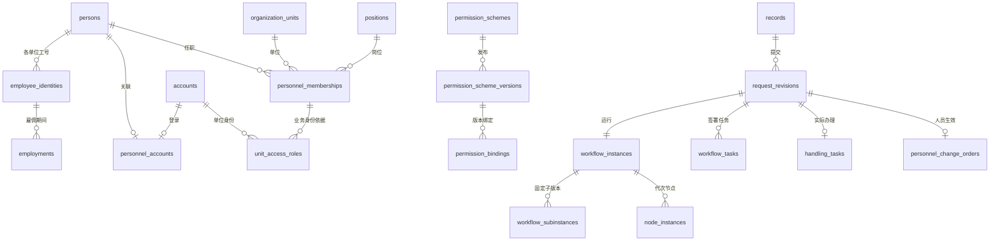

# 账号、组织与 OA 新基线数据字典

核对日期：2026-10-31。本文描述源码中的 schema 11；验收结果见[本轮执行记录](./OA重构验收与功能保留台账.md)。SQLite 桌面与 PostgreSQL 18 团队服务使用同一用例和规则，各自的物理 DDL、模型指纹分别计算。

## 基线与唯一来源

`crates/export-doc-storage/src/schema.rs` 固定 `SCHEMA_VERSION = MIN_SUPPORTED_SCHEMA_VERSION = 11`。完整 DDL 由下列六组文件组合，不能把其中一个增量脚本应用到已有库：

| 文件前缀 | 内容 |
| --- | --- |
| `sqlite.sql` / `postgres.sql` | 原业务记录、组织、账号关联、任职、授权、文件、历史、配置与凭据 |
| `identity_runtime_` | 公开人员、账号和组织名称的规范化事实、只读投影 |
| `personnel_foundation_` | 岗位、单位工号、雇佣期间、有限项目及职责 |
| `permission_versions_` | 不可变权限发布版本、主体版本绑定 |
| `access_scope_` | 显式限制及单位/部门/项目集合 |
| `workflow_runtime_` | 不可变申请版本、流程实例、节点任务、实际签署、办理、执行订单和命令回执 |

后五组分别以 `sqlite.sql` 或 `postgres.sql` 结尾。模型指纹是上述源码按固定顺序、统一 LF 换行、以零字节分隔后的 SHA-256；另记录实际数据库结构指纹。启动和恢复核对版本、模型及实际结构，拒绝旧库、空文件、损坏、缺表、模型不匹配和未知版本，并保留原文件。PostgreSQL 初始化/恢复使用独立维护连接，API 连接没有 DDL 权限。

## 身份、组织和授权

| 表 / 字段 | 含义和约束 |
| --- | --- |
| `records.id/kind/version` | 受管记录编号、资源类型、乐观并发版本；保留原销售、制单、付款等独立业务种类 |
| `organization_units.id/parent_id` | 稳定经营单位 ID 及层级；代码和名称是可编辑属性 |
| `organization_departments.id/unit_id` | 部门属于一个单位；编辑/删除使用稳定 ID |
| `persons.id` | 自然人公开事实；姓名不作身份键，不含联系方式等私密档案正文 |
| `personnel_private_profiles.person_id` | 私密档案独立保存，公开目录与任职查询不读取私密正文 |
| `accounts.id/username/role_code/source_mode` | 登录身份；用户名唯一；权限来源为独立配置或已发布方案 |
| `credentials` | 密码等受控认证资料，与公开目录分离 |
| `personnel_accounts.person_id/user_id` | 人员与登录账号关联；关联/解除关联复核双方版本及未结职责 |
| `positions.id/unit_id/department_id/code` | 岗位属于指定单位及可选部门；单位内代码唯一，同范围名称唯一 |
| `employee_identities.person_id/unit_id/employee_number` | 一个人在一个单位的一套工号身份；单位内工号唯一 |
| `employee_number_history` | 保留工号占用历史，防止同单位历史串人 |
| `employments.identity_id/starts_on/ends_on/stage` | 雇佣期间，阶段 Probation/Regular/Departed；半开区间不重叠，结束须晚于开始 |
| `personnel_memberships.id/person_id/unit_id/department_id/position_id` | 稳定任职 ID，关联人员、单位、部门及岗位；主职唯一；再次任职生成新 ID |
| `personnel_memberships.starts_on/ends_on` | 任职自然日期范围；接口中空日期表示开放边界，结束当天仍有效，与雇佣半开区间分别校验 |
| `reporting_relations.appointment_id/manager_appointment_id` | 行政/职能汇报指向明确任职；校验有效期、单位和循环 |
| `organization_duties.appointment_id` | 单位/部门负责人职责，不以姓名或账号管理权限替代 |
| `responsibilities/responsibility_assignments` | 单位内职责目录与任职分配；可限制流程种类和项目，分配有有效期间 |
| `project_scopes/project_memberships` | 仅用于 OA 找人的有限项目范围及 Member/Leader 任职；不关联客户、订单或单证 |
| `unit_access_roles` | 账号在单位中的业务、协作或管理身份、有效期及能力上限；业务身份绑定任职 |
| `permission_schemes` | 可编辑权限方案草稿及所属范围 |
| `permission_scheme_versions(scheme_id,version)` | 发布正文、发布时间及发布人；已发布行禁止修改/删除 |
| `permission_bindings(principal_kind,principal_id)` | Account/Unit 主体绑定一个具体发布版本；保存草稿不改变现有绑定 |
| `account_grants/unit_access_grants` | 相应身份的模块操作及 own/department/company/all 基础范围 |
| `access_restrictions` | 主体、资源、操作唯一；Deny/Unrestricted/Units/Departments/Projects/Participation 限制模式，含原因和版本 |
| `access_scope_members` | 限制集合的成员；每行只引用单位、部门、项目三者之一 |

授权读取先解析当前身份、方案版本和产品能力，再应用个人/身份限制及资源策略。技术维护账号不具备业务签署资格；实际签署者须关联在职人员。任职到期不删除历史签名，返聘或重新任职不恢复已结束身份的权限。

## 申请、审批和办理

| 表 / 字段 | 含义和约束 |
| --- | --- |
| `request_revisions(request_id,revision)` | 不可变提交正文和材料快照；唯一提交序号，禁止更新/删除 |
| `workflow_instances.id/request_id/revision/generation` | 提交版本对应的根实例；执行代次 1–1000，状态与办理状态分别保存 |
| `workflow_instances.definition` | 提交时冻结的发布版本、条件解析及流程设置 |
| `workflow_subinstances` | 父实例、固定定义版本、提交材料、输入快照、展开节点和状态；绑定禁止改写 |
| `node_instances(instance_id,generation,node_key)` | 节点定义、顺序、实际开始及到期时间、提醒级别 0–2；每代最多 32 个节点位置 |
| `workflow_tasks(request_id,submission,generation,task_key)` | 指定审批账号/身份、实际办理账号/身份、状态、时间、代理依据及签署事实 |
| `workflow_tasks.signature/source_generation` | 当前代次真实签署，或引用之前代次的有效签署；不能同时伪造一份新签署 |
| `workflow_operations` | 加减签、退回、暂停等受控操作的执行人、身份、原因、代次及详情；禁止改写/删除 |
| `handling_tasks` | 审批后的实际办理 Pending/InProgress/Completed/Blocked/Cancelled；`result_status` 表示资源/业务办理结果 |
| `personnel_change_orders` | 冻结的人员变动提交版本、批准执行身份、生效时间及 Pending/Applied/Blocked/Cancelled 状态 |
| `command_receipts(actor_id,context_id,command_key)` | 当前身份的幂等键、请求摘要、目标、已提交结果及时间；同键同文返回回执，不同正文冲突 |
| `workflow_current_tasks/task_decisions/workflow_plans/record_rows` | 从规范化事实组合的查询视图，不维护第二份可独立修改的审批状态 |

批准/拒绝/退回的任务必须包含实际执行账号、开始和完成时间、耗时及签署；Waiting/Skipped/Cancelled 不能包含实际签署。已签署任务及其跨代引用受数据库不可变保护。指定节点退回保留不受影响的有效签署，重新审核的节点清空原核验值和确认项。

人员变动的立即生效与定时生效共用原子提交用例。到期重新核对人员版本、当前权限及交接状态，失败保留 Approved/Blocked 供处理；重新核验不能覆盖期间新事实，取消未生效变动保留原签署。提醒以当前提交、代次、有效节点和提醒级别进行条件更新，重启或重复调度不重复发送，不自动批准。

## 查询、材料及输出边界

常用索引覆盖单位/部门/人员关系、职责有效期间、权限版本绑定、主体资源限制、待办账号/状态/期限、实际签署人、实例代次及人员变动到期队列。流程操作的审批候选按账号 ID 游标，每次最多检查 100 个公开账号，再核验当前业务资格；客户端通过 `nextCursor` 加载后续候选。流程设置的人员目录分别返回审批候选和办理候选，办理权限不会隐含授予审批权，保存分工时仍按事项复核查看及办理动作。

详情、列表、待办、通知、历史、材料下载、审批单和 ZIP 共用字段/附件投影规则。审批任务提供所获准申请材料的访问资格，不附带全量人员、销售、制单或付款权限。通用存储的 JSON 承载资源正文，不允许页面、HTTP 路由或用例直接拼接 SQL。

自然日采用 `YYYY-MM-DD`，时间点采用带偏移的 RFC 3339。金额仍按原精确十进制用例和契约处理。文件、模板、附件、原业务资料及备份继续遵守受管 DataRoot，不为新 OA 增加第二数据库或默认外部文件目录。

## 关系概览

图中为主要业务关系，精确外键、可空性、触发器和索引以同目录的两库 DDL 为准。
