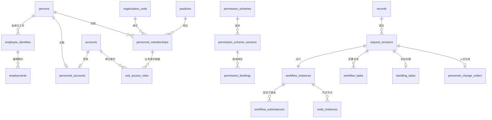

# 账号、组织与 OA 新基线数据字典

核对日期：2026-11-10。本文描述源码中的 schema 17；自定义事项和独立设置版本见[本批记录](./archive/2026-11/2026-11-10自定义OA重构与验收.md)。独立申报资料及 `sourceId` 新基线见[联调记录](./archive/2026-11/2026-11-09独立申报与联调记录.md)，schema 14/13/12 的历史结果见[重构实施记录](./archive/2026-11/2026-11-06重构实施与验收记录.md)、[二期记录](./archive/2026-11/二期重构验收与清理记录.md)和[OA 执行记录](./archive/2026-11/OA重构验收与功能保留台账.md)。SQLite 桌面与 PostgreSQL 18 团队服务使用同一用例和规则，各自的物理 DDL、模型指纹分别计算。

## 基线与唯一来源

`crates/export-doc-storage/src/schema.rs` 固定 `SCHEMA_VERSION = 17`，只接受这一版本。完整 DDL 由下列七组文件组合，不能把其中一个脚本应用到已有库：

自定义 OA 使用 `oa-definition-draft` 分别保存每个流程草稿，`oa-setting-section` 保存日历、代理、办理分工和审批单模板，`oa-approval-settings` 只保存发布目录。`revisions` 提供各编辑单元的 CAS 版本；删除未发布草稿保留版本墓碑，防止旧编辑器覆盖重建内容。发布内容继续进入不可变 `oa-definition-version`。`oa-general` 保存事项键、定义版本、冻结表单、原始值和服务端解析的显示值；显示值沿用原始字段的材料权限。两库均有按单位/事项/编号的分页索引。旧 schema 16 及以下数据库明确拒绝，不修改版本标记。

| 文件前缀 | 内容 |
| --- | --- |
| `sqlite.sql` / `postgres.sql` | 原业务记录、组织、账号关联、任职、授权、文件、历史、配置与凭据 |
| `identity_runtime_` | 公开人员、账号和组织名称的规范化事实、只读投影 |
| `personnel_foundation_` | 岗位、单位工号、雇佣期间、有限项目及职责 |
| `permission_versions_` | 不可变权限发布版本、主体版本绑定 |
| `access_scope_` | 显式限制及单位/部门/项目集合 |
| `workflow_runtime_` | 不可变申请版本、流程实例、节点任务、实际签署、办理、执行订单和命令回执 |
| `foreign_key_indexes.sql` | 两库共用的 42 个外键前缀索引，覆盖经核对后仍缺少索引的引用方向 |

身份、人员、权限、限制及流程五组分别以 `sqlite.sql` 或 `postgres.sql` 结尾；外键索引文件由两库共用。模型指纹按 `schema.rs` 中的固定顺序、统一 LF 换行、以零字节分隔后计算 SHA-256；另记录实际数据库结构指纹。启动和恢复核对版本、模型及实际结构，拒绝旧库、空文件、损坏、缺表、模型不匹配和未知版本，并保留原文件。PostgreSQL 初始化/恢复使用独立维护连接，API 连接没有 DDL 权限。

2026-11-01 在同一尚未生产部署的 schema 11 基线中修正未签任务的稳定人员列与回读、签署不可变保护。模型/结构指纹随完整 DDL 改变；此前生成但指纹不同的 schema 11 测试库和备份同样拒绝打开/恢复，使用新的隔离数据根或数据库。没有追加迁移链，也不自动改写或删除原数据。

2026-11-02 高级流程及任职历史使用全新 schema 12。新增字段、关系及输入权限来源检查进入完整基线和指纹；此前 schema 11 或开发期间不同指纹的测试库不能直接打开。新建、打开、备份恢复均只使用当前完整基线；没有旧库转换、旧 API 解析或运行时双写分支。

## 身份、组织和授权

2026-11-09 使用全新 schema 16：`records` 中增加独立申报快照种类 `sw-sources`，单一窗口草稿、批次以 `sourceId` 引用发票或独立快照。复用公司/所有者/部门权限和检索投影，预览不写记录；独立来源不创建发票。旧 schema 14 数据库及备份拒绝打开/恢复，须显式新建数据根或 PostgreSQL 数据库。

2026-11-06 使用全新 schema 14：任职历史按不可变 `request_revisions` 统计并增加 appointment 表达式索引；两库统一子流程绑定不可变保护及同值更新语义。旧库、旧备份和不同模型指纹均拒绝打开/恢复，不自动删除。模板历史容量为各提供者 JSON 文本表示的 UTF-8 字节估算，用于本库清理提示，不承诺跨库字节相等或物理磁盘释放量。

schema 13 定稿同时统一两库的规范化检索键序与 PostgreSQL 结构化搜索缓存。`exportdoc_record_text` 在建表前定义，`search_document` 与完整检索使用相同紧凑表示；64 KiB 边界和权限来源保留。模型指纹包含这些表达式，同版但不同指纹的开发期数据库/备份同样拒绝打开或恢复。

2026-11-04 二期冻结 schema 13：补齐外键索引、移除恒空的 `history.body` 与无消费者的 `task_decisions` 视图，并统一 SQLite 检索字段的键序。正式历史 `history`、可清理审计 `audit_logs`、不可变流程操作/快照和被外键引用的复合唯一键继续保留。旧 schema 12 数据库及备份拒绝打开/恢复，使用显式新 DataRoot 或新 PostgreSQL 数据库；没有旧库迁移或自动删除。

| 表 / 字段 | 含义和约束 |
| --- | --- |
| `records.id/kind/version` | 受管记录编号、资源类型、乐观并发版本；保留原销售、制单、付款等独立业务种类 |
| `organization_units.id/parent_id` | 稳定经营单位 ID 及层级；已有代码不改写，名称可编辑 |
| `organization_departments.id/unit_id` | 部门属于一个单位；编辑/删除使用稳定 ID |
| `persons.id` | 自然人公开事实；姓名不作身份键，不含联系方式等私密档案正文 |
| `personnel_private_profiles.person_id` | 私密档案独立保存，公开目录与任职查询不读取私密正文 |
| `accounts.id/username/role_code/source_mode` | 登录身份；用户名唯一；权限来源为独立配置或已发布方案 |
| `credentials` | 密码等受控认证资料，与公开目录分离 |
| `personnel_accounts.person_id/user_id` | 人员与登录账号关联；关联/解除关联复核双方版本及未结职责 |
| `positions.id/unit_id/department_id/code` | 岗位属于指定单位及可选部门；单位内代码唯一，同范围名称唯一 |
| `employee_identities.person_id/unit_id/employee_number` | 一个人在一个单位的一套工号身份；单位内工号唯一 |
| `employee_number_history` | 保留工号占用历史，防止同单位历史串人 |
| `employments.identity_id/starts_on/ends_on/stage` | 雇佣期间，阶段 Probation/Regular/Departed；半开区间不重叠，结束须晚于开始 |
| `personnel_memberships.id/person_id/unit_id/department_id/position_id` | 稳定任职 ID，关联人员、单位、部门及岗位；开放主任职唯一；岗位改名保留已有岗位 ID |
| `personnel_memberships.is_primary/ends_on` | 当前主任职为主职且结束为空；已结束主任职投影到 assignmentHistory，当前兼职与历史主任职分开。离职状态另行使当前任职失效 |
| `personnel_memberships.starts_on/ends_on` | 任职自然日期范围；接口中空日期表示开放边界，结束当天仍有效，与雇佣半开区间分别校验 |
| `reporting_relations.appointment_id/manager_appointment_id` | 行政/职能汇报指向明确任职；校验有效期、单位和循环 |
| `organization_duties.appointment_id` | 单位/部门负责人职责，不以姓名或账号管理权限替代 |
| `responsibilities/responsibility_assignments` | 单位内职责目录与任职分配；可限制流程种类和项目，分配有有效期间 |
| `project_scopes/project_memberships` | 当前经营单位的有限项目及 Member/Leader 任职期间，作为 ProjectLeader 审批来源并检查申请人成员身份；不关联商业资料 |
| `unit_access_roles` | 账号在单位中的业务、协作或管理身份、有效期及能力上限；业务身份绑定任职 |
| `permission_schemes` | 可编辑权限方案草稿及所属范围 |
| `permission_scheme_versions(scheme_id,version)` | 发布正文、发布时间及发布人；已发布行禁止修改/删除 |
| `permission_bindings(principal_kind,principal_id)` | Account/Unit 主体绑定一个具体发布版本；保存草稿不改变现有绑定 |
| `account_grants/unit_access_grants` | 相应身份的模块操作及 own/department/company/all 基础范围 |
| `access_restrictions` | 主体、资源、操作唯一；Deny/Unrestricted/Units/Departments/Projects/Participation 限制模式，含原因和版本 |
| `access_scope_members` | 限制集合的成员；每行只引用单位、部门、项目三者之一 |

授权读取先解析当前身份、方案版本和产品能力，再应用个人/身份限制及资源策略。技术维护账号不具备业务签署资格；实际签署者须关联在职人员。任职到期不删除历史签名，返聘或重新任职不恢复已结束身份的权限。

## 申请、审批和办理

| 表 / 字段 | 含义和约束 |
| --- | --- |
| `request_revisions(request_id,revision)` | 不可变提交正文和材料快照；唯一提交序号，禁止更新/删除 |
| `workflow_instances.id/request_id/revision/generation` | 提交版本对应的根实例；执行代次 1–1000，状态与办理状态分别保存 |
| `workflow_instances.definition` | 提交时冻结的发布版本、条件解析及流程设置 |
| `workflow_subinstances` | 固定子版本、入口/结果出口、冻结条件输入、输出聚合、父子关系、传播/补偿政策和控制结果；绑定及输入禁止改写，sources 对象记录材料来源 |
| `node_instances(instance_id,generation,node_key)` | 节点阶段、类型、执行状态、实际操作、错误、期限、提醒和逐级升级游标；每代最多 32 个节点位置 |
| `workflow_node_actors(instance_id,generation,node_key,actor_id,context_id,activation_level)` | 冻结账号、自然人、身份、任职/职责来源与管理办理标志；直接分派为 0、升级级别为 1–4，同一身份的各级来源分别保存，当前动作权限及来源资格另行复核 |
| `workflow_instances.participants` | 有界实际参与人及代理责任人索引，保留部分归还和重试的独立复核依据，不替代原始签署 |
| `workflow_tasks(request_id,submission,generation,task_key)` | 指定审批账号/身份、实际办理账号/身份、状态、时间、代理依据及签署事实 |
| `workflow_tasks.assignee_person_id` | 非空稳定人员 ID，外键引用 persons；未签回读同样返回 approverPersonId，移交更新此列，已签记录不可改写 |
| `workflow_tasks.signature/source_generation` | 当前代次真实签署，或引用之前代次的有效签署；不能同时伪造一份新签署 |
| `workflow_operations` | 加减签、退回、暂停等受控操作的执行人、身份、原因、代次及详情；禁止改写/删除 |
| `handling_tasks` | 每申请/提交的办理汇总；具体人工/系统办理事实位于 node_instances，result_status 保存专用业务结果 |
| `workflow_activations` | 定时发布的固定版本、活动版本及启停状态预期、执行身份、请求摘要、时刻、CAS 版本与 Pending/Applied/Blocked/Cancelled 状态 |
| `personnel_change_orders` | 冻结的人员变动提交版本、批准执行身份、生效时间及 Pending/Applied/Blocked/Cancelled 状态 |
| `command_receipts(actor_id,context_id,command_key)` | 当前身份的幂等键、请求摘要、目标、紧凑提交结果及时间；同键同文读取当前合法结果，不同正文冲突；不复制整份审批计划 |
| `workflow_current_tasks/workflow_plans/record_rows` | 当前运行与完整签署投影；workflow_list_plans/workflow_list_records 提供轻量列表，workflow_record_filters 提供筛选事实；实际签署直接来自 workflow_tasks，不保留 task_decisions 重复视图 |

批准/拒绝/退回的任务必须包含实际执行账号、开始和完成时间、耗时及签署；Waiting/Skipped/Cancelled 不能包含实际签署。已签署任务及其跨代引用受数据库不可变保护。指定节点退回保留不受影响的有效签署，重新审核的节点清空原核验值和确认项。

人员变动的立即生效与定时生效共用原子提交用例。到期重新核对人员版本、当前权限及交接状态，失败保留 Approved/Blocked 供处理；重新核验不能覆盖期间新事实，取消未生效变动保留原签署。提醒以当前提交、代次、有效节点和提醒级别进行条件更新，重启或重复调度不重复发送，不自动批准。

## 查询、材料及输出边界

容量回归追加 `records.search_document` 受限生成列：正文序列化不超过 64 KiB 时，写事务内生成已规范化的检索文本；超限返回 NULL，查询继续使用原全文规则。普通静态记录的文字搜索复用该列，身份、流程申请及提交档案投影和 PostgreSQL 结构化/转义搜索仍读取当前正文，不缓存权限。提交档案从冻结关系重建申请与运行计划，通用搜索使用相同投影，不依赖已移出原记录正文的材料。删除始终为空的旧 `search_text` 存储列；生成列不出现在 API 材料中。SQLite 的纯 JSON/Unicode 函数在建库及验证前注册，指纹随当前完整 schema 17 DDL 更新，此前不同指纹测试库须显式新建。

常用索引覆盖单位/部门/人员关系、职责有效期间、权限版本绑定、主体资源限制、待办账号/状态/期限、实际签署人、实例代次及人员变动到期队列。流程操作的审批候选按账号 ID 游标，每次最多检查 100 个公开账号，再核验当前业务资格；客户端通过 `nextCursor` 加载后续候选。流程设置的人员目录分别返回审批候选和办理候选，办理权限不会隐含授予审批权，保存分工时仍按事项复核查看及办理动作。

详情、列表、待办、通知、历史、材料下载、审批单和 ZIP 共用字段/附件投影规则。审批任务提供所获准申请材料的访问资格，不附带全量人员、销售、制单或付款权限。通用存储的 JSON 承载资源正文，不允许页面、HTTP 路由或用例直接拼接 SQL。

明确分派和代理不绕过主体显式限制；SQL 先对普通范围与参与范围的并集应用限制，再计数/分页，代理同时携带原责任人的限制。材料只使用当前激活节点；没有当前任务时才使用已激活的历史参与规则。未来分派不能提供完整材料，完整下载在取文件的快照中重新检查。

公开参与查询使用类型化的业务自然日，并在 SQL 中复核当前任职、岗位、职责期间、项目和汇报来源；普通列表、审批队列及通知计数一致排除失效职责。内部交接/引用审计保留失效责任事实。办理动作撤权后历史绑定不提供继续读取的资格；督办知会只要求查看权限，真实历史签署不被改写。

自然日采用 `YYYY-MM-DD`，时间点采用带偏移的 RFC 3339。金额仍按原精确十进制用例和契约处理。文件、模板、附件、原业务资料及备份继续遵守受管 DataRoot，不为新 OA 增加第二数据库或默认外部文件目录。

## 关系概览

图中为主要业务关系，精确外键、可空性、触发器和索引以同目录的两库 DDL 为准。
