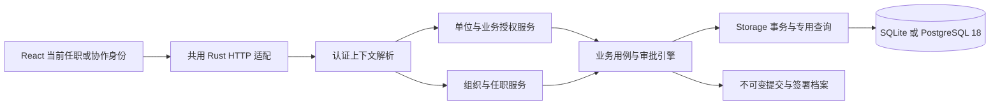

# 集团组织、任职与授权重构设计

> 2026-10-29 修订。用户进一步明确：参考泛微、致远、华天动力、蓝凌，整体重构组织、人员、授权与 OA；不兼容旧数据库，也不兼容旧 OA 接口。本文记录设计决策，实际实现与验收见[实施清单](./OA统一模型重构实施清单.md)。schema 10 已在 SQLite/PostgreSQL 18 及真实 React/Tauri 场景中验证，以两库各自完整 DDL 发布，不建立旧库迁移链。旧接口形状不再限制新模型；未受影响的单证、报表等功能契约继续保持。

## 1. 结论与范围

采用**统一组织、统一人员身份、按任职与单位授权的模块化单体**。单公司是相同模型中只有一个经营单位的情况，无需开启集团模式或维护虚构总部。出现子公司后添加单位和授权，沿用同一人员、账号、流程引擎和数据库。

集团能力需要公司层级、多单位任职、单位范围管理授权与跨单位流程共同成立。这些应作为完整基础模型设计，不再将任职和分级管理员仅写成没有实际模型的“扩展预留”。实现按闭环交付，未通过验收的部分保持不可用，不先发布空接口。

保留 Tauri＋React＋Rust、桌面 SQLite、团队 PostgreSQL 18、一套 API 和一个后端实例。集团属于一个组织内部的多单位协作，不等于多个互不信任客户共用的 SaaS 多租户；不同客户仍使用独立部署。不新增 tenant 平台、微服务、消息队列或第三方 BPM 产品依赖。

## 2. 官方资料与取舍

以下官方页面于 2026-10-29 直接读取。公开资料说明产品能力；没有公开证据的厂商数据库表、内部服务拓扑和默认权限算法不作推断。

| 官方来源 | 可核对的内容 | 本项目采用的原则 |
| --- | --- | --- |
| [泛微央国企平台](https://guoqi.weaver.com.cn/) | “既支持集团统一管理，也支持各下属单位分级分权独立管理运维”，以及“一人多岗、一人多单位兼职” | 人员身份唯一；单位管理范围与任职分别建模 |
| [致远组织管理](https://www.seeyon.com/NewPro/desc/id/23.html) | 多级单位/部门；公司和分子公司访问按规则授权；单位管理员；多单位兼职和多维组织 | 单位树与部门树分开；按单位授权，不由隶属关系推导全部访问权 |
| [通达 T20](https://www.tongda2000.com/t20/) | 多维架构、一人多岗、矩阵管理、集团分级分权；岗位/职务/角色/用户组的细粒度授权 | 正式组织、业务角色、流程找人各有职责，未来项目组织另行扩展 |
| [华天动力集团版](https://www.oa8000.com/html/jituanoa/index.html) | 统一组织、统一用户、统一待办；权限下放子公司；功能应用、数据管理、数据查看分离；按岗位责权驱动流程 | 集中身份、分级管理；流程资格、管理范围、业务可见范围分开；以待办和交接形成办事闭环 |
| [蓝凌 EKP](https://www.landray.com.cn/static-old/solution/ekp/index.html) | 集团门户和数据权限分级；流程审批要点；流程仿真、效率分析；表单字段可显/不可见及字段权限 | 发布前模拟路由；审批人看到明确审查要点；过程和耗时可追溯；管理摘要与业务内容分开投影 |

本轮再次直接读取以上泛微、致远、华天动力、蓝凌官方页面；不把广告指标当作独立性能证据，也不推断厂商的私有数据库结构。“优秀部分”按本项目的适用性取舍：泛微的集团分权、致远的统一组织与多任职、华天动力的责权与业务办理闭环、蓝凌的流程仿真与审批指引。微服务、通用低代码平台、完整 BPMN 引擎、AI、即时通讯和完整 HR 套件不是本项目集团支持的前置条件。

## 3. 四个独立维度

| 维度 | 表达的事实 | 不隐含的权限 |
| --- | --- | --- |
| 单位及部门 | 管理隶属、资料归属、组织名称 | 总部不自动查看子公司档案；父部门不自动管理后代 |
| 人员及任职 | 谁在何单位、部门担任何职，向哪个任职汇报 | 职位名称、主职/兼职不自动授予系统操作 |
| 业务角色及单位授权 | 指定单位中的资源、动作、可见范围和有效期 | 审批资格不代表任意审批；单位管理不代表财务/私密档案查看 |
| 流程实例及任务 | 哪一轮、哪个节点由谁负责，谁实际签署 | 任务分派不授予全公司数据，不改变人事任职 |

组织单位也不同于出口商、收款单位、客户和供应商档案；不得因名称或代码相同将其合并为权限单位。暂不实现股权比例、合并报表口径或完整法人治理。

## 4. 单位树、人员与任职

### 4.1 单位树

- 单位使用稳定内部 ID；关系外键引用 ID。代码创建后固定，名称可改；部分用例以不可变代码定位单位，部门代码必须同时携带单位边界，不能按显示名称或单独部门代码关联。
- 类型为组织集团 `Group` 和经营单位 `Company`。Company 可以是总公司、子公司或需独立管理的分支，不根据名称推断法人资格。
- 普通公司可直接作为根并拥有部门。需要纯管理层时才创建 Group；Group 表达管理范围，不创建虚构的业务任职，也不作为 OA 或单证归属。总部工作人员在总部 Company 任职；管理授权可以以 Group 为范围根。
- Company 也可以拥有下属 Company，不限两级。部门只属于一个经营单位，父部门必须在同一单位。
- 保留最多 32 层保护，拒绝循环、孤立引用及有启用下级时停用上级。任职、流程或业务仍引用的组织不物理删除。
- 正式单位树不同时承担股权树、项目矩阵和报表合并关系。

### 4.2 一个自然人，多个任职

- 人员 ID 全系统唯一；登录账号关联人员，不为兼职或集团协作复制账号。
- 主任职和兼任职使用同一实体，包含单位、部门、职位、生效/终止日期和状态。人员概览的主公司/主部门从有效主任职投影。
- 在职人员必须有一个有效主任职，同一时点最多一个；切换主任职不更换人员 ID。工号按当前产品规则继续全系统唯一。
- 行政直属、职能汇报分别记录，绑定申请人的任职并指向负责人任职，避免同一个人在多个单位履职时身份不明。
- 公司/部门的主负责人和按业务分管负责人引用任职。同一人在不同单位承担的职责分别维护，线上操作仍需显式授权。
- 通讯录只显示该单位任职的公开身份；兼职不会开放他人的证件、私密附件、家庭信息及其他单位人事记录。
- 临时审批协作可没有正式兼任职：以有期限的单位角色授权参与，保留“协作授权”身份，不伪造人事任职。

职位目录保持轻量，不引入薪酬、职等套级和编制管理。未来项目团队另加组织关系类型，复用人员/任职引用与授权解析，不改写正式单位树。

## 5. 单位授权与分级管理

### 5.1 每个上下文独立计算权限

保留 `resource/action/dataScope` 和可复用权限方案。角色分配增加单位范围、任职或协作身份、有效期、授权来源。主公司权限不能直接带进子公司。

同一人员可在甲公司使用部门审批方案，在乙公司使用普通员工方案。选择当前任职/协作身份后，服务端只解析该上下文的一个明确配置。相同上下文需要兼任职责时，沿用显式编辑/组合权限方案，不把所有公司、所有任职权限隐式取并集。

上下文由单位角色分配的稳定 ID 标识，而不是只用公司名：它同时确定本次业务单位、权限配置及可选任职来源。正式业务身份绑定目标单位的具体任职，任职结束即失效。临时跨单位协作不绑定正式任职，必须具有在职人员身份、针对目标业务单位的明确角色分配、结束时间及授权来源；离职或授权失效后拒绝访问。

业务范围分为两维：单位边界，以及单位内部的本人、明确参与事项、指定部门/授权下级部门、全单位。集团汇总是独立查看授权；查询在计数/分页前使用授权单位集合，不能通过清空 `companyScope` 获得全局数据。写入、审批和办理仍定位一个单位及具体对象。

### 5.2 管理权与业务权分开

| 身份/职责 | 可管理内容 | 须另外授权的内容 |
| --- | --- | --- |
| 系统管理员 | 实例设置、组织建立、授权边界、备份恢复及平台维护 | 业务审批职责不因平台身份自动产生 |
| 集团组织管理员 | 获授单位集合内的组织与任职 | 各单位业务、财务、私密档案和系统配置 |
| 单位管理员 | 本单位获授的组织、成员、局部角色和流程配置 | 他司、集团方案、平台账号凭据及备份 |
| 业务审批人 | 获授业务的明确流程任务 | 他人草稿、未分派事项及全部单位数据 |
| 人事/行政/财务经办 | 对应资源、动作和范围 | 审批、付款、系统管理等其他职责 |

单位管理员是带单位范围的管理授权，不新增绕过检查的全局 Admin，不通过 `Actor.admin=true` 模拟。组织维护、任职维护、局部业务授权、流程维护分别授权。

单位管理员只可分配授权者允许下放的业务权限，不能授予更大范围、全局 `all`、平台能力、集团方案编辑或继续外部转授权。账号凭据及全局停用仍由平台管理；本单位只结束本单位任职/授权，不能锁死该人在其他单位的账号。私密档案另由人事资源权限控制。

管理范围默认只含指定单位，“含下级”须显式开启并展示范围。动态含下级授权会覆盖后续加入子树的单位，因此调整父级须在同一事务核验操作者范围、重新计算授权影响并审计。扩大跨边界管理范围只能由有相应集团授权的管理者办理。

### 5.3 限制优先

账号停用、人员状态、任职失效、单位停用、授权到期/撤销与产品能力限制都在操作前核验。关闭模块、仅本人及参与事项等限制不被方案组合或技术依赖重新开放。审批、审批后作废和实际办理继续分别授权。

## 6. 总公司与子公司的流程

每个流程定义明确业务归属单位、发布者和不可变发布版本。集团可提供可复制模板，由目标单位显式发布。模板更新不静默替换子公司版本，在途实例沿用提交版本。

找人规则统一输出人员、账号、任职/协作授权以及任务所属单位：申请任职的部门负责人、直属/职能负责人，本业务单位领导，指定管理单位的职责/角色，或明确指定的已授权人员。

跨单位路径使用明确目标单位或“沿管理上级查找某职责”的类型化规则，不用职位名称字符串、任意脚本或默认跳到最高领导。解析候选后仍核验目标业务单位授权；没有合格候选时阻止发布/提交，不猜人或自动批准。

例如：子公司采购→子公司部门负责人→超过金额阈值时集团采购分管角色→子公司采购经办。金额沿用精确十进制。集团审批人只读取明确任务、必要凭证及历史，不获得全部采购或员工档案。兄弟公司也能通过明确协作授权参与，不限制为“只能上级审批下级”。

跨公司使用同一审批内核，保留会签/或签、并行汇合、退回、代理、移交及 PDF。本人回避与独立复核按人员及实际账号检查，不能通过切换任职重复签署。

撤销授权、结束任职、调岗和组织职责变化前，检查发布定义、正在进行/等待激活任务、办理分工及业务归属。显式移交或停用新提交入口，历史签名不改写。临时授权到期提前进入管理待办；未完成交接也不能绕过到期限制，任务保留并明确提示待交接。

## 7. 新数据库模型

组织、身份和授权使用明确实体与关系约束；申请正文、扩展表单及不可变快照继续复用现有 records/BLOB，不为集团另建第二套 OA 或数据库。

下表是新基线逻辑结构，实际 DDL 在实现时与 Rust 存储模型同步确定；它不是厂商私有表结构，也不是已部署数据库。

| 实体 | 核心字段/关联 | 约束与索引 |
| --- | --- | --- |
| `organization_units` | id、code、name、kind、parent_id、status、version | code 唯一、父级 FK/索引；树循环在事务中校验 |
| `departments` | id、unit_id、code、name、parent_id、status、version | `(unit_id, code)` 唯一；父部门同单位复合 FK |
| `persons` | id、employee_number、姓名/公开联系方式、status、version | 工号全局唯一；不以主公司列代表全部任职 |
| `personnel_profiles` | person_id、档案责任单位、私密资料/附件引用、version | 公开身份和私密查询分开，私密读取独立授权 |
| `appointments` | id、person_id、unit_id、department_id、job_title、is_primary、valid_from/to、status、version | 部门同单位 FK；人员/单位/状态索引；日期及主任职唯一在同一写事务检查 |
| `reporting_relations` | appointment_id、manager_appointment_id、relation_type | 同类边去重、任职图无自环/环、有效期/状态检查 |
| `organization_responsibilities` | unit_id、department_id 可空、appointment_id、primary/functional、workflow_kind | 每经营单位/部门一位主负责人，分管职责去重，负责人任职与单位一致；Group 范围的管理者使用管理授权 |
| `permission_profiles` | id、owner_unit_id 可空、名称、资源/动作/内部范围、version | 集团模板与单位方案管理范围分开，复用现有解析器 |
| `unit_role_assignments` | id、user_id、context_appointment_id 可空、unit_id、profile_id、valid_from/to、status、version | 正式任职与协作可区分；账号/单位/有效期索引；一个选定上下文使用一个明确配置 |
| `administration_grants` | subject_user_id、root_unit_id、include_descendants、管理能力、可下放业务权限上限、有效期、version | 管理和业务分开；不能写平台权限；事务内重验范围 |

账号关联 `person_id`，非空时一人一账号。平台维护账号可无人员身份，但不能伪造申请任职。创建账号、业务负责人和申请人员分别保存。

流程和通用业务记录需要保留：业务单位、申请人员/任职、创建账号、当前负责人、版本；发布定义所属单位及版本；冻结的组织名称/职位/汇报解析结果；任务责任账号/人员/任职或协作授权；实际办理身份、代理、轮次、节点、状态和期限。审计中的历史授权快照只解释当时事实，不授予当前权限。

外键禁止级联删除历史。索引优先覆盖单位＋状态＋时间、人员＋有效任职、账号＋单位角色、任务单位＋责任人＋状态。常规查询不能读取整批完整 JSON 后才过滤权限。

部门代码改为单位内唯一，各子公司无需协调全局代码；组织编辑/删除 API 使用稳定 ID，原 code 路由退役。其他正文及上下文仍以不可变公司代码和单位内部门代码定位，由关系投影转换为 ID 并执行外键约束；不建立 code/ID 双轨解析。该实现决策保留明确且不可变的业务键，不能表述为所有 API 字段均已 ID 化。

当前物理表为 `organization_units`、`organization_departments`、`personnel_memberships`、`reporting_relations`、`organization_duties`、`personnel_accounts`、`unit_access_roles`、`unit_access_grants`、`permission_schemes` 与 `workflow_tasks`，版本化实体正文仍在 records。私密 profile 单独存于 `personnel_private_profiles`。上述逻辑实体不要求每个都另建一套正文表；投影在同一事务发布，唯一性、外键和版本并发约束均由两库合同验证。

### 7.1 全新基线切换

1. schema 10 为当前新基线，两库完整 DDL 使用同一个版本，由正式常量统一管理；schema 9 和早期试验库均拒绝。
2. 只在确认数据库不存在时初始化；旧库、空文件、损坏库、未知/超前版本与旧备份拒绝且保留。
3. 不迁移旧试验库、不猜测归属、不补造任职或历史；验证使用全新 DataRoot/新 PostgreSQL 数据库。
4. 旧隔离测试库按已有授权核对来源、占用、链接和保留边界后单独清理，启动器不自动删除数据库。
5. PostgreSQL DDL继续由维护账号执行，普通 API 无 DDL权限；两库共用业务合同，不设 SQLite 特殊审批分支。

## 8. 上下文与模块职责

- Domain：组织/汇报图、有效期、纯权限范围计算、审批规则，不查询数据库。
- Engine：组织、任职、授权、流程各自编排；账号/任职/授权与职责检查同事务。
- Storage：关系约束、身份查询、授权过滤和任务索引，SQL 不进入 Engine。
- Contracts：唯一 OpenAPI，统一生成两端客户端；未实现/验证的接口不先发布。
- React：一个有效身份时直接进入工作区；多个身份才显示单位/任职选择。集团、跨单位低频设置默认折叠。

服务端上下文至少包含账号、人员、任职或协作授权、当前单位、有效业务/管理范围和相应版本。客户端只选择服务端返回的身份，不能自行声明公司或管理员权限。

切换身份替换会话并撤销旧令牌；前端执行草稿离开保护，取消旧请求/预览、清空隔离缓存后进入新工作区。只切换下拉框不算完成。

事务内重验保留所选单位/任职，不能只用 user_id 重建主公司 Actor。后台任务保存发起单位和身份，在执行、发布、下载时重新计算当前授权；不保存访问令牌或用历史权限快照长期放行。

待办可聚合多个授权身份的必要摘要，但明确所属单位；点击后经过切换保护。通知、附件、历史、PDF、导出和统计使用同一对象授权，摘要和下载不能绕开单位边界。

## 9. 已核对的源码改造位置

| 改造位置 | 重构前行为/风险 | 本轮模型要求 |
| --- | --- | --- |
| `engine/auth.rs`、`engine/store.rs` | Actor及事务刷新按账号主公司生成 | 当前上下文解析，读写事务保留/重验任职与单位 |
| `personnel_organization` 的 Domain/Engine 模块 | 主职字段＋同公司兼职数组，负责人同公司过滤 | 统一任职，汇报指向任职，公开目录与私密档案分开 |
| `account_permissions.rs`、`accounts.rs` | 方案绑定账号，Admin全局放行 | 每上下文业务授权与有上限的单位管理权 |
| `oa/approval.rs`、`oa/settings.rs` | 候选/代理按主公司核验，流程设置依赖全局管理员 | 业务单位有效授权和单位流程管理能力 |
| `oa/approval_references.rs`、`handling/account_references.rs` | 主要检查账号主公司职责 | 覆盖受影响单位、等待和进行中任务、办理及业务归属 |
| `reports/jobs.rs`、`tasks/persistence.rs` 等 | 多处后台任务按账号 ID重建Actor | 保存/复核发起身份和单位，覆盖发布与下载 |
| React组织页、任职编辑器、导航和权限范围 | 管理入口依赖Admin，人员候选按主公司 | 单位能力控制入口，选择任职，缓存/草稿/直达链接一致 |

上一稿未实现的 `approvalParticipants` 与切换会话契约不作为本设计基础：公司对象内的审批名单无法承接任职、分级管理和后台上下文。撤下草稿接口，在统一模型实现后生成正式契约。上一批已有的多负责人、权限方案、职责保护、列表和 OA页签修复继续保留。

## 10. 实施顺序与验收

顺序：新基线与领域约束→身份/单位授权→人员与分级管理→跨单位路由及后台路径→React/Tauri联调→集中门禁与交付。每步必须有真实业务入口，不以空字段或可编译结构体宣称已支持。

| 场景 | 必须证明的结果 |
| --- | --- |
| 普通单公司 | 一个主任职、简洁入口，日常申请/办理/打印闭环 |
| 总公司、两家子公司、孙公司 | 层级回读；循环、停用、跨边界移动受约束 |
| 一人两公司任职 | 同一账号，部门/职位/汇报/权限/冻结值分别正确 |
| 同人多个身份与代理 | 本人回避、独立复核不被切换身份绕过 |
| 单位管理员 | 范围内维护成功；改他司、提权、私密读取、全局停用他人账号拒绝 |
| 子公司→总部、兄弟公司协作 | 明确授权及路由后办理；未分派和未授权内容不可见 |
| 集团汇总 | 计数/分页前过滤单位；移出授权子树/撤权后范围及时改变 |
| 到期、撤权和交接 | 发布定义、等待/进行中任务、办理及业务归属完整；历史不改写 |
| 并发 | 撤权与写入竞争时重验；不留下半条任职/授权/审计 |
| 身份切换与后台任务 | 旧令牌失效；草稿受保护；旧响应不串界面；任务/PDF公司正确且复核下载 |
| 建库与恢复 | 两库同合同；旧schema/备份拒绝且不覆盖 |

最终执行项目规定的 Rust workspace、all-features、生成契约、真实 PostgreSQL 18与SQLite、React真实HTTP、Tauri及实际PDF，以及脚本、依赖治理和源码门禁。其他OS/架构、系统IME候选窗和实体打印分别记账。

集团查询、单位管理员、多单位任职、跨单位审批和会话切换已实现，并通过本批 SQLite/PostgreSQL 18 业务合同及真实界面联调。普通单公司仍按单一身份使用，集团与跨单位能力按需配置。当前有界审批图不包含子流程、任意节点退回、运行中加减签、比例会签或自动升级；系统 IME 候选窗、实体打印及其他 OS/架构仍须独立验收，具体证据见实施清单及当日进度。
